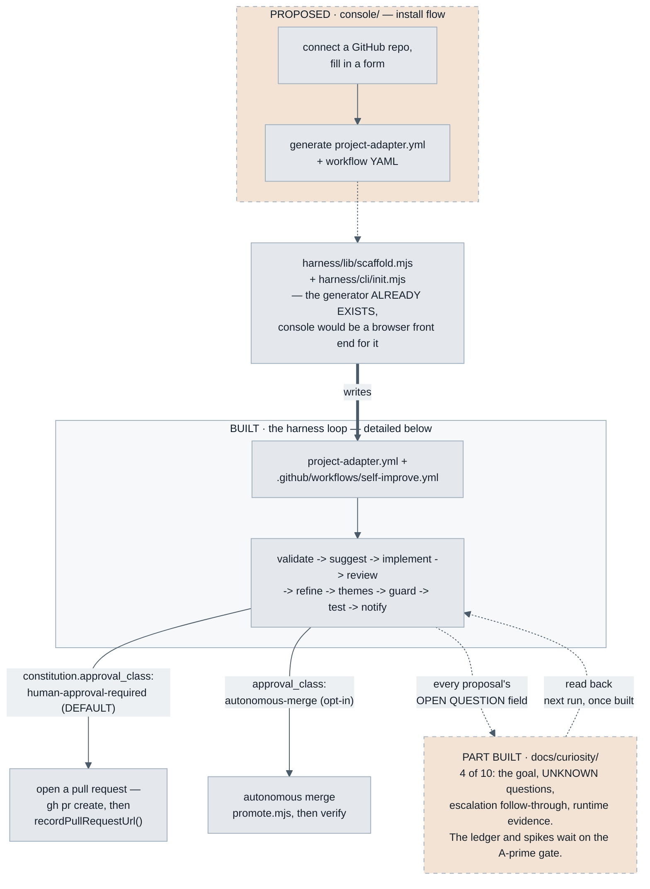
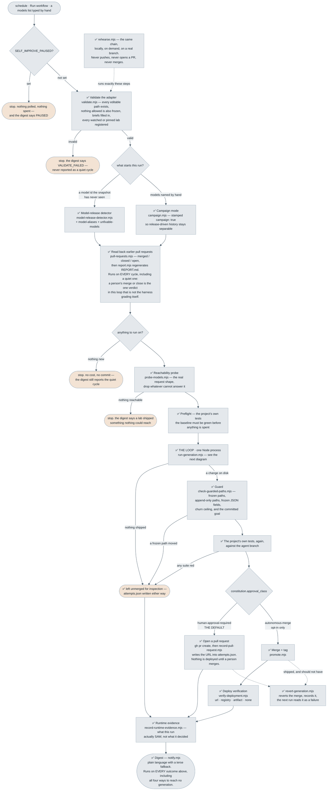
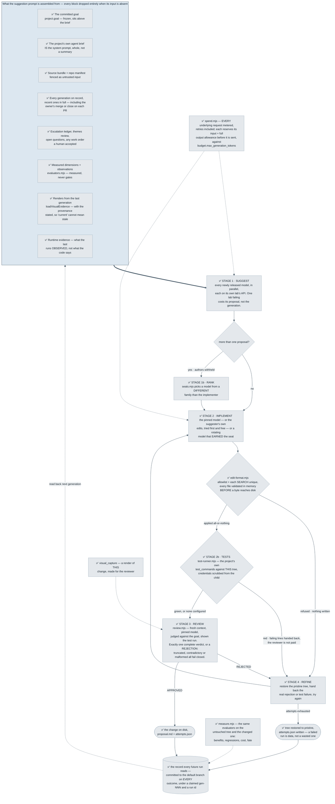
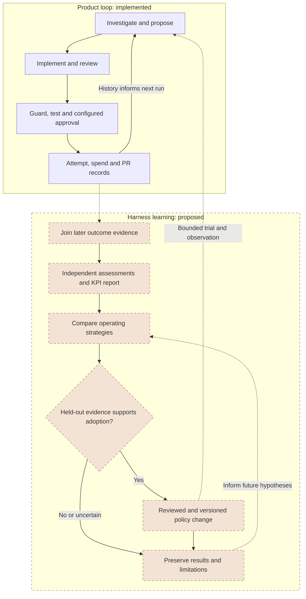

# Architecture — what's actually built, in pictures

**Console implementation update — 11 September 2026:** the browser installer
is now implemented. `console/app.mjs` calls explicit HTTP endpoints;
`configuration.mjs` validates input and calls the existing scaffolder;
`github.mjs` performs installation-scoped GitHub operations through App
user access tokens held in memory by `api.mjs`. The initial workflow is
manual and PR-only; activation requires a separately reviewed PR after
verified rehearsal gates. See [implementation status](console/IMPLEMENTATION.md)
and [deployment configuration](console/DEPLOYMENT.md). Live authenticated
acceptance is still outstanding. The first diagram below is retained as the
**pre-implementation architecture snapshot**, not a current console status claim.


This page exists because the other diagrams in this repository each answer a
different question, and none of them answers "what does *self_optimisation
itself* actually have working today" — which is the one a first-time visitor
usually wants. Read this page for that. Read `learning/diagrams/` for the
portable pattern you'd lift into another project. Read
`Portable-Harness-Design.md` §7 for the prose mapping between the two.

## Diagram layers, and which one you want

| Layer | Where | Shows |
|---|---|---|
| **The project before the console implementation** | Below, on this page — new, added to answer "how do console/harness/curiosity relate" | Console + harness + curiosity as one picture, solid where built, dashed where proposed — the only diagram that spans all three |
| **This repo's real status (the harness alone)** | Below, on this page — now **two** diagrams: one cycle end to end, then what happens inside the loop | What's actually built in the harness specifically. Everything drawn is real code with a test file; the warm-toned boxes are the ways a cycle ends without shipping, not unbuilt work |
| **Portable pattern** | [`learning/diagrams/generic-loop.mmd`](learning/diagrams/generic-loop.mmd), `generic-guardrails.mmd`, `generic-context.mmd` — embedded and viewable in [`learning/02-blueprint.md`](learning/02-blueprint.md) and [`learning/05-guardrails-and-trust.md`](learning/05-guardrails-and-trust.md) | The abstract loop and guardrail layers, project-neutral — what you'd draw for *any* installation, including one that isn't this harness at all |
| **Reference implementation, concretely** | [`learning/diagrams/worked-example-run.mmd`](learning/diagrams/worked-example-run.mmd), `worked-example-harness.mmd` — both embedded below since GitHub doesn't render a bare `.mmd` file as a picture | The same pattern as it actually runs in the reference implementation (real job names, real check counts, real token costs) — useful for seeing what the abstraction looks like once it's hit a real, live system |
| **Proposed, not built** | [`learning/diagrams/proposed-curiosity-run.mmd`](learning/diagrams/proposed-curiosity-run.mmd), `proposed-curiosity-memory.mmd`, `proposed-curiosity-authorisation.mmd`, indexed at [`docs/curiosity/README.md`](docs/curiosity/README.md) | The curiosity design's own three diagrams — a second longitudinal pass, four of its ten components built and the rest proposed. Do not read the dashed nodes as documentation of the harness. |
| **Proposed KPI learning** | [Two-loop design below](#proposed-kpi-learning-loop), with [sidecar source](learning/diagrams/proposed-kpi-learning-loop.mmd) and [measurement specification](docs/harness-kpis/README.md) | Existing product-run records feed proposed outcome assessments, controlled operating-strategy experiments and reviewed policy adoption. Measurement automation is not built. |

## Historical project snapshot, in one picture

Console, harness, and curiosity live at three different maturity levels, and
no other diagram in this repository shows them on the same page. Solid boxes
are real and running; dashed, warm-toned boxes are not yet fully real — the
same convention [`learning/diagrams/README.md`](learning/diagrams/README.md)
uses for the curiosity diagrams, applied here to the console too. Curiosity
is dashed because most of it is unbuilt, not all: four of its ten components
have shipped, and the box says which.



Two things this picture makes visible that no prose paragraph had said in
one place before: the console's real prerequisite (the generator) already
exists under a different name than its own design doc guessed
(`harness/lib/scaffold.mjs`, not a new `install.mjs`) — see console/DESIGN.md
§2.1 for the now-superseded original argument; and curiosity has exactly
three attachment points onto the loop, all additive, none of them requiring
the loop itself to change shape.

## What's actually built here, today

**Two diagrams, because there are two questions.** The first is *what one
cycle does*, from the schedule firing to an email arriving — the order the
generated workflow actually runs, including all five ways a cycle can end
without shipping anything. The second is *what happens inside the loop*: the
one Node process where suggest → implement → review → refine lives, and
everything that feeds the prompt it starts from.

Everything in both is real code with its own test file. `harness/cli/init.mjs`
and `harness/templates/workflow.yml.tmpl` chain all of it into one generated
workflow for a new project, and `harness/scripts/rehearse.mjs` runs the same
chain locally, on demand — so nothing here is a human invoking each script by
hand any more.



**One cycle, above.** Every box is real code with its own test file. The
five rounded, warm-toned boxes are the ways a cycle ends without shipping
anything — and each of them still sends a digest saying *which* kind of
nothing happened, because "the loop checked and there was nothing to do"
and "the loop never ran" are the same silence from an inbox
(`learning/03-failure-modes.md` records three separate times that
distinction was collapsed, each found only after a month's email failed to
arrive).

**Inside the loop, below.** The box marked THE LOOP above is one Node
process, because a review → refine → review cycle has to be able to loop and
GitHub Actions cannot loop a job.



**Read these diagrams as what's real, not a roadmap with checkboxes filled
in.** Every box is real: the detector via
`init --detector-only` (or inside the full workflow), the whole chain locally via
`harness/scripts/rehearse.mjs`, and the loop via
`harness/scripts/run-generation.mjs` run directly — `npm test` prints the
current check count against fake
model responses, plus `tests/e2e/full-loop.test.mjs`: two automated tests
that drive the whole chain — suggest → implement → review → guard → test →
promote (autonomous merge) → verify → notify — in the generated workflow's
real order, against a real git remote and a real child-process test run,
faking only the three model calls. One proves the happy path merges and the
digest correctly says so; the other proves an exhausted-attempts run merges
nothing and the digest correctly says that too. This automates what used to
be a one-off manual run: a real end-to-end pass against a temp project with
a real adapter and real brief files (no API key configured, which correctly
produced a `no-proposal` outcome rather than crashing on a wiring bug — see
`Portable-Harness-Design.md`'s Bucket B table for that verification in
detail) — the manual run stays true as a record of what was checked before
the automated version existed. `check-guarded-paths.mjs` runs standalone against a real git diff;
`promote.mjs` (merge + tag) was verified against a real two-repo git setup
including an actual merge conflict; `verify-deployment.mjs` now implements
all four `deployment.verify_strategy` values — `url` (poll a live site,
compare canonicalised content, timeout), `registry` (poll npm/PyPI/NuGet/
Maven Central for the tagged version — four real, differently-shaped APIs,
not one faked shared shape), `artifact` (build, confirm the output path
exists, optionally smoke-run it), and `none`; `notify.mjs` sends a
plain-language digest with a reliable terse fallback, delivery behind a
`registerSender()` registry so SendGrid is one registered sender, not a
hardcoded dependency. What used to be "each piece real but nothing chains
them" is now chained: `harness/templates/workflow.yml.tmpl` renders validate
-> detect -> probe -> preflight -> improve -> themes -> guard -> test ->
pull request (or promote -> verify) ->
notify as one sequential-steps GitHub Actions job (Actions can't loop or
dynamically branch jobs — see the reference-implementation diagram below
for what that constrains), and `harness/cli/init.mjs` asks the
Portable-Harness-Design.md §6 questions and writes that workflow plus a
filled `project-adapter.yml`, brief-template copies, and a short install
README for a new project — verified against a real, fresh git repo end to
end, and via `tests/lib/scaffold.test.mjs` parsing every strategy
combination's generated YAML back with `js-yaml` to confirm it's valid.

**The merge model, reconciled (was the known gap here):** the template used
to render only autonomous merge. It now renders one of two paths, chosen at
scaffold time from `constitution.approval_class` — a field that until this
change was parsed by nothing.

- **`human-approval-required`** is the default, and the fallback for any
  unrecognised value. Every gate runs against the agent branch; then the
  workflow opens a pull request with `gh pr create` and records its URL
  back into that generation's `attempts.json` via
  `harness/scripts/record-pull-request.mjs`. It runs no deployment
  verification, because nothing is deployed until a person merges.
- **`autonomous-merge`** is the opt-in: `promote.mjs` merges and tags, then
  `verify-deployment.mjs` checks what that shipped.

Exactly one path is written into the generated file, so which merge model a
repository got is answerable by reading its workflow rather than by
cross-referencing an adapter field against harness code. Unrecognised values
fail closed to the pull-request path (`harness/lib/adapter.mjs`'s
`normalizeApprovalClass()`), because a typo must never be the reason a
project starts merging its own changes unattended — `console/DESIGN.md`
§Step 7: "defaulting a non-technical user into autonomous merge is the
single worst decision this console could make."

The `schedule:` block is likewise now optional (`console/DESIGN.md` §Step 9's
two-phase onboarding): rendered by default for `init`, omitted — leaving a
`workflow_dispatch`-only workflow and a commented cron to add later — when
the installer asks for it. Until then there is no cron in the repository to
fire, which makes "the schedule stays off until a rehearsal passes" a fact
about the file rather than a promise about the process.

`Portable-Harness-Design.md`'s Status table has the same information as
prose, kept in sync by hand — if the two ever disagree, trust whichever was
edited more recently and fix the other.

## Proposed KPI learning loop

The product loop already records attempts, spend, tests and PR disposition.
The second loop is a proposed measurement and policy-evaluation design; no live
KPI scorecard, experiment scheduler or automatic strategy adaptation is installed.
A merged PR supplies disposition evidence, not proof of product effectiveness.
Warm-toned dashed nodes and their connecting design flow describe proposed work.



Candidate strategies may change context selection, memory retrieval or retry
policy. They cannot change their own assessment labels, weaken gates, expand
write permissions or bypass the configured approval class. Adoption requires
held-out evaluation followed by a bounded real-project trial and continued
observation. This learns operating policy from experience; it does not train
foundation-model weights.

The current generated operational report describes merged or kept changes and
resource use. The proposed independently assessed scorecard is distinct. See
[workflow evidence mapping](docs/harness-kpis/workflow-integration.md) for existing
artifacts, missing collection points and the workflow changes that depend on them.

## The reference implementation, concretely

The abstract loop above, as it actually runs in the reference implementation
— real job names, real check counts. Two diagrams, embedded here because a
bare `.mmd` file renders as plain text on GitHub, not a picture (see
[`learning/diagrams/README.md`](learning/diagrams/README.md)'s "three
mechanical traps" for why sidecar files still exist despite that). Both are
byte-for-byte the same structure as their `learning/diagrams/` sidecars —
keep it that way; a hand-edited copy here that quietly drifts from the
sidecar is the exact mistake this note exists to prevent.


That is the reference implementation's real 7-job workflow — 18+
generations run against it, including the incidents `learning/03-failure-modes.md`
catalogs. Every stage in it that isn't already ✅ in this page's status
diagram above is genuinely unbuilt in `self_optimisation` yet.

The harness diagram — the same reference implementation, but token flow and
per-provider dispatch instead of the CI job sequence:


Both diagrams describe the reference implementation, carrotgame — the check
counts (98+601+19), token estimate (~59k), and provider-dispatch table are
its numbers, not `self_optimisation`'s own.

---

## Status in detail

The diagrams above show this same information as a picture — what's built,
what a human still does by hand, and how the two connect. The table below is
the same status kept in sync by hand; if it ever disagrees with the diagram,
trust whichever was edited more recently.

| Component | Status |
|---|---|
| Provider router (`harness/lib/llm-provider.mjs` + `harness/providers/`) | ✅ Built, tested |
| Bounded patch executor (`harness/lib/edit-format.mjs`) | ✅ Built, tested |
| Model-release detector (`harness/lib/model-release-detector.mjs`) | ✅ Built, tested |
| Reachability probe (`harness/lib/probe-models.mjs`) | ✅ Built, tested |
| Adapter loader (`harness/lib/adapter.mjs`, reads `project-adapter.yml`) | ✅ Built, tested — one of the two files in the harness that use `js-yaml` (vendored in `harness/vendor/`, so never installed), and the one that loads it lazily |
| Adapter validation (`harness/lib/validate.mjs`, `harness/scripts/validate.mjs`) | ✅ Built, tested — every editable path exists, allowed paths never overlap frozen or append-only ones, `.github/**` is frozen unless deliberately overridden, brief files exist and are flagged for unfilled `[placeholder]`s, every watched or pinned lab is registered and warned about if its key is missing. Run by `init` (advisory), `rehearse` (blocking), and as the generated workflow's own first step — a failure reaches the digest as its own no-generation reason, never as a quiet cycle |
| Local rehearsal (`harness/lib/rehearse.mjs`, `harness/scripts/rehearse.mjs`) | ✅ Built, tested — the same chain the generated workflow runs (validate → preflight → detect or campaign → probe → a local `agent/gen-NNN` branch → the real orchestrator → guard → tests), as a thin sequencer over the same CLIs the workflow calls, so it can never drift from what the workflow does. Never pushes, opens a pull request, or merges; deterministic and network-free with no lab key configured |
| Context compiler (`harness/lib/context-pack.mjs`) | ✅ Built, tested (7 of 9 functions — screenshots/scorecard stay project-specific plugins) — wired: `run-generation.mjs` calls its builders to assemble every prompt |
| **Orchestrator** (`harness/lib/orchestrator.mjs` + `harness/scripts/run-generation.mjs`) | ✅ **Built, tested, and runnable** — suggest → implement → review → refine, end to end, against your own adapter and brief files |
| Independent reviewer (`harness/lib/review.mjs`) | ✅ Built, tested, wired into the orchestrator |
| Guard (`harness/lib/guard.mjs`, reads `constitution.*` from the adapter) | ✅ Built, tested — still awaiting a workflow step that runs it against a real PR from the orchestrator, since that's CI wiring, not harness code |
| Automated evaluator — test-command runner (`evaluation.test_commands`) | ✅ Built, in the two places it belongs. In CI it needs no harness *code*: a project's test commands are rendered straight into the generated workflow as steps, the same way the guard runs as one, so a run fails on the commands CI actually ran. `harness/scripts/rehearse.mjs` reads the adapter's own copy to run the identical gates locally — the one deliberate reader of that field, documented in `adapter.mjs`'s `evaluationConfig()` |
| Quality-dimension evaluator plugins (`harness/lib/evaluators.mjs`, `harness/plugins/evaluators/`) | ✅ Built, tested, wired — the measurements that are explicitly **not** gates. A plugin gets the working tree and the generation record and returns named metrics; it cannot fail a generation, however badly it behaves. One shipped example (`source-weight`), the interface documented, ecosystem-specific plugins (Checkstyle, mypy, Roslyn, the canvas checks) left as extension points |
| Probes that render, simulate or observe — and the two sockets that carry what they saw ([`docs/Tool-Use-Design.md`](docs/Tool-Use-Design.md) phase 1) | ✅ Built, tested — a plugin may now write into one given directory and return **images** and **observations**, not just numbers. Images from the last generation are attached to the next suggestion call (with their provenance stated, so "current" cannot mean a stale render); observations are read into its prompt. `evaluation.visual_capture` runs the same interface *inside* a generation so the **reviewer** sees a render of the change under review. This is where Blender, a physics probe or a headless browser belongs — the harness ships none of them and has no opinion about your ecosystem. Phases 2–5 (a tool contract, MCP, model-authored tools) are design only |
| Runtime evidence (`harness/lib/runtime-evidence.mjs`, `context-pack.mjs`'s `buildRuntimeEvidence()`) | ✅ Built, tested, wired (`docs/curiosity/C10`): what the tests, the deploy check and any project probe **actually observed**, read back into the next generation's prompt. Every other block in that prompt describes what the project *is*; this is the only one that describes what it *did*. Observations, never scores — and when the budget runs out it is the totals that go, not a skipped test's name |
| Escalation follow-through — work orders, resurfacing, the minority report (`harness/lib/escalations.mjs`, `orchestrator.mjs`) | ✅ Built, tested, wired (`docs/curiosity/C8`): an escalation a human accepts becomes a queued work order that the next ambitious generation is handed and told to deliver, and the outcome is written back — the first label in this project that scores its own *reasoning* rather than its code. An entry nobody has engaged with for N generations is put to the fan-out by name and must be answered AGREE / DISAGREE / IRRELEVANT, because silence was being scored as rejection |
| Failure & proposal memory — escalations ledger (`harness/lib/escalations.mjs`), themes review (`harness/lib/themes.mjs`, `generate-themes.mjs`, `harness/scripts/generate-themes-review.mjs`) | ✅ Built, tested, wired: the orchestrator folds every run's proposals into the ledger and reads it back into the next prompt, and every `memory.themes_review.cadence_generations` generations one model is asked what principle explains the last N — written to `docs/themes/review-NNN.json`, read back into every prompt after it |
| Staging & promotion — merge + tag (`harness/lib/promote.mjs`), deploy verification (`harness/lib/verify-deployment.mjs`) | ✅ Built, tested — all four `verify_strategy` values: `url` (poll + compare), `registry` (npm/PyPI/NuGet/Maven Central), `artifact` (build/path/smoke-run), `none`. Chained automatically by the generated workflow (`harness/templates/workflow.yml.tmpl`). |
| Notifier — plain-language digest with a reliable fallback (`harness/lib/notify.mjs`, `harness/scripts/send-digest.mjs`, `send-escalation-notice.mjs`) | ✅ Built, tested — sender is pluggable (`registerSender()`; SendGrid ships built in, Slack/webhook/another email API are added by registering one under its own name), calibration examples are optional project config, not hardcoded. Chained automatically by the generated workflow. |
| `init` CLI scaffolder (`harness/cli/init.mjs`) | ✅ Built — asks the Portable-Harness-Design.md §6 questions and writes `project-adapter.yml`, the generated workflow, brief-template copies, an install README and checklist for a new project. `--quick` asks five questions and defaults the rest; `--detector-only` writes the release-notice workflow alone |
| Project detection (`harness/lib/detect-project.mjs`) | ✅ Built, tested — proposes `init`'s editable paths, test commands and setup commands from `package.json`, `pyproject.toml`, `Cargo.toml`, `go.mod`, `pom.xml`, Gradle, `*.csproj` and a `Makefile`. Reads, never runs |
| GitHub setup (`harness/lib/github-setup.mjs`, `init --configure-github`) | ✅ Built, tested against a fake `gh` — uploads exactly the secrets an installation calls (values on stdin, never argv), ticks the pull-request permission and reads it back. Not yet run against a real repository's settings |
| Installation check (`harness/lib/doctor.mjs`, `harness/scripts/doctor.mjs`) | ✅ Built, tested — Node, adapter, workflow, env file git-ignored, keys accepted, snapshot, GitHub secrets and permission, harness version, each failure with the command that fixes it. `--offline` calls nothing outside the machine |
| Cost accounting + budget cap (`harness/lib/spend.mjs`, `budget.max_generation_tokens`) | ✅ Built, tested — every underlying request is metered (headroom and text-only retries each count) and reserves its estimated input plus its whole output allowance *before* it is sent, so a parallel fan-out or a retry cannot overshoot the cap; a refused call ends the attempt loop as `budget-exhausted`, never a crash. Every `attempts.json` carries `spend`, with failed and refused requests counted separately. Tokens, not money |
| Tests inside the repair loop (`harness/lib/test-runner.mjs`, `evaluation.test_in_loop`) | ✅ Built, tested, **proven on real runs** — a baseline on the untouched tree, then the project's own `test_commands` against each attempt before it is reviewed; a failure goes back to the implementer as its failing lines. The child process never sees a credential. In both real campaigns so far a suggester's own edits failed the tests and the loop repaired them ([`docs/campaigns/`](docs/campaigns/)) |
| Before/after measurement (`harness/lib/measure.mjs`, `run-evaluators.mjs --baseline`) | ✅ Built, tested — the same evaluators, fingerprinted, on the untouched tree and the changed one; `comparison.json` names benefits and regressions by each metric's declared direction, beside cost; `REPORT.md` adds what a person did with each change |
| Generation identity and records (`harness/lib/generation-id.mjs`, `persist-records.mjs`) | ✅ Built, tested against a real remote — the next number is one past any tag, agent branch or record; the branch is claimed with a lease; every record carries a run id and is committed to the default branch on every outcome, failures included. The agent branch carries code only |
| Strict review verdict (`review.mjs`'s `parseVerdict()`) | ✅ Built, tested — exactly one `VERDICT:`, exactly APPROVED or REJECTED, an approval must end `END OF REVIEW` and list no required fixes; truncated, contradictory or malformed responses are rejections, and an unreadable review is asked once more before an attempt is spent |
| Pull-request read-back (`harness/lib/pull-requests.mjs`, `harness/scripts/sync-pull-request-outcomes.mjs`) | ✅ Built, tested — merged / open / closed written into the record at the top of every cycle; a closed pull request breaks the clean streak and reaches the next prompt as CLOSED UNMERGED |
| Rollback (`harness/lib/rollback.mjs`, `harness/scripts/revert-generation.mjs`) | ✅ Built, tested against a real remote on both merge paths — reverts the shipped merge, records `reverted`, the next run reads it as a failure |
| The ambition dial (`context.ambition`, [`docs/Ambition-Control.md`](docs/Ambition-Control.md)) and scope-aware ranking | ✅ Built, tested — `focused` / `earned` (default) / `ambitious`, read at run time, per-run override from the Actions tab; the ranking rubric follows the scope; a lone ambitious failure no longer resets the streak |
| Seats (`harness/lib/seats.mjs`) — cross-family ranker, seat promotion | ✅ Built, tested — the rank seat defaults to another lab's model from the snapshot; a rotating model whose own edits keep being approved and kept can earn the implement seat (`roles.promotion`, off by default); the review seat is never auto-assigned |
| Harness KPIs and practical strategy learning ([`docs/harness-kpis/`](docs/harness-kpis/)) | Design and templates only. Existing spend, attempt and PR records are inputs; independent outcome assessments, a verified KPI scorecard and controlled policy adaptation are not implemented. |
| Operational report (`harness/lib/report.mjs` → `<generationsDir>/REPORT.md`) | ✅ Built, tested — the paper's §7 metrics from the records, regenerated every cycle, never hand-edited |
| Run history page (`harness/lib/run-history.mjs` → `<generationsDir>/index.html`) | ✅ Built, tested — one self-contained page for the owner: every generation newest first, the change in plain words, its outcome and pull request, failed attempts with their reasons, tokens and cache savings, pull requests waiting for review, open escalations. Rebuilt after every run with the record and at the start of each cycle once fates are read back. Every installation gets it; no configuration |
| Campaign mode (`harness/lib/campaign.mjs`, the workflow's `models` input) | ✅ Built, tested — a generation now, on models named by hand, recorded as `campaign: true` |
| The committed goal (`project.goal`, [`docs/curiosity/C1`](docs/curiosity/C1-committed-goal.md)) and the themes review's `UNKNOWN` field ([`C2`](docs/curiosity/C2-themes-review-cli.md) phase A) | ✅ Built, tested — the goal sits above the brief, the reviewer rejects drift from it, the guard refuses a diff that edits it; a review may name open questions, rendered as their own section and dropped when none |
| Kill switch, version stamp, pinned supply chain | ✅ Built, tested — `SELF_IMPROVE_PAUSED` repository variable; `harness/VERSION` in every adapter and record; actions by SHA, `js-yaml` vendored and hash-pinned, nothing installed at run time |
| Shared-workflow installation (`harness/lib/workflow-config.mjs`, `harness/scripts/render-shared-workflow.mjs`, `renderCallerWorkflow()`) | ✅ Built, tested — instead of copying `harness/`, the target repository gets a small caller workflow that calls this repository's `.github/workflows/self-improve.yml` at a pinned commit. Note the behavioural difference: in this mode `evaluation.test_commands` and `setup_commands` are LIVE (the shared workflow runs them) rather than RECORDED |
| `templates/` — generated workflow (`harness/templates/workflow.yml.tmpl`), agent brief, reviewer brief | ✅ Built, tested (`tests/lib/scaffold.test.mjs` parses every strategy combination's generated YAML back to confirm it's valid); guard config has no separate template — it's `constitution.*` in `project-adapter.yml` itself |

`Portable-Harness-Design.md` §10 has the full build order and reasoning for
what comes next and why.

## How the three pieces fit together

This repository is really three things at three different stages, meant to
compose into one journey — read this before the per-piece docs so the status
marks in the table above don't read as contradictions:

1. **Install** (implemented; deployment configuration required): the console
   provides ten setup steps backed by the real generator, complete bundle
   downloads, GitHub App sign-in, repository discovery, secret-name checks,
   setup PR creation, rehearsal dispatch and gate-based activation PRs. Keys
   are entered directly on GitHub, never in the console. GitHub operations
   require the App variables in [`console/DEPLOYMENT.md`](console/DEPLOYMENT.md).
   Automated integration tests use fake GitHub responses; a live authenticated
   acceptance run is still required. Existing installations are not overwritten.
2. **Run** (✅ built): the generated workflow validates the adapter, checks
   the watched labs, and once a new model appears runs the real suggest →
   implement → review → refine → guard → test → **pull request** → notify
   loop end to end (autonomous merge, and the deployment verification that
   follows it, are the opt-in path). `harness/scripts/rehearse.mjs` runs the
   same chain locally on demand, so this stage can be exercised without
   waiting for a release — see the diagrams at the top of
   this file. This is the only one of the three
   stages that runs unattended today.
3. **Learn** (🚧 partly built): `docs/curiosity/` designs a second, slower
   pass over the same run history — harvesting open questions from every
   proposal, promoting the corroborated ones into a themes review, and
   occasionally spending a whole generation on a sourced document instead of
   a diff. Four of its ten components are built (C1 the goal, C2's `UNKNOWN`
   field, C8 escalation follow-through, C10 runtime evidence); the rest wait
   on the A′ go/no-go (`WORKPLAN.md` 4.3a). Every component attaches onto a
   file the loop already writes and renders nothing when its input is
   absent, so a repository with no run history yet is unaffected — see "Cold
   start" in [`docs/curiosity/README.md`](docs/curiosity/README.md#cold-start-the-first-runs-must-work-with-none-of-this).
   Separately, [harness KPIs](docs/harness-kpis/README.md) proposes learning
   operating strategy from independently assessed real-world outcomes. It
   compares policies on held-out tasks and bounded project trials; live KPI
   collection and policy adaptation are not built. Curiosity raises questions;
   KPI experiments test whether a proposed way of working actually helps.

**The seam between stage 1 and stage 2, now closed:** the generated workflow
used to always auto-merge an approved change (`harness/lib/promote.mjs`),
which is the opposite of what the console design calls for. It now renders
one of two paths from `constitution.approval_class` — open a pull request
(the default, and where any unrecognised value lands) or merge autonomously
(the opt-in) — and the `schedule:` block is optional, so an installation can
ship dispatch-only until a rehearsal has passed. See "The merge model, reconciled"
above for the full account.

## The bet this depends on

This whole design rests on one external assumption, worth stating plainly
rather than leaving implicit: **frontier labs keep shipping, and each new
model is meaningfully better than the last.** Neither is something this
repository controls, and if either stops being true the loop quietly stops
proposing anything — which is the correct behaviour, not a failure. So it's
worth checking the bet against outside data rather than asserting it.

**Are they still shipping?** [AI Release Tracker](https://aireleasetracker.com/analytics)
provides an independent release-cadence view. The redesigned console explains
its own behaviour without embedding a third-party tracker or maintaining a
copy of its changing figures.

**Are they getting better in the way that matters here?** The most useful
public measure is METR's **50% task-completion time horizon**: how long a
task takes a skilled human, at the length where an AI agent completes it
successfully half the time. It matters for this project specifically because
it tracks *how much of a change a model can carry unattended* — which is the
thing a governed autonomous loop is actually buying.

| Model | 50% time horizon |
|---|---|
| Claude Opus 4.5 | 320 min |
| GPT-5 | 214 min |
| o3 | 121 min |

Doubling time of that horizon, measured across models released since 2024:
**~89 days**.

Figures from METR's Time Horizon 1.1 set, via
[metr.org/time-horizons](https://metr.org/time-horizons/) (page last updated
8 May 2026; quoted here rather than embedded because METR publishes no
embeddable chart). Carry METR's own caveats with the numbers: confidence
intervals are wide, the trend is sensitive to which tasks are in the suite,
and measurements above 16 hours are unreliable on the current one.

The connection to this repository is direct. A rotating suggest seat is only
worth the plumbing if a genuinely new mind arrives often enough to be worth
asking — that's the first chart. And the curiosity design in
[`docs/curiosity/`](docs/curiosity/) is a bet on the second: if models keep
getting better at long tasks, the binding constraint shifts from *can it
write the change* to *did anyone point it at the right question*.

## The shape of it, in one paragraph

A model release is the trigger, not the calendar. One seat rotates — whichever
lab shipped the newest model gets to propose the change, on its own API, with
fresh eyes. Every other seat (implement, review) stays pinned to a model
you already trust. Proposals are targeted, exact edits — never a full-file
rewrite — applied all-or-nothing and checked against a project's own test
suite before anything merges. An agent can argue that a frozen rule is wrong,
but it cannot change the rule itself; only a human can, and only after
independent models converge on the same complaint. Every run — including the
ones that ship nothing — writes down what it tried, and the next run reads
that back. `learning/01-principles.md` has the full list, each one anchored
to a real incident rather than stated as a bare rule.

## Repo layout (current, not final — see `Portable-Harness-Design.md` §4)

```
self_optimisation/
├── README.md                        # this file
├── ARCHITECTURE.md                  # five diagrams: the project, the loop, inside the loop
├── WORKPLAN.md                      # the sequenced plan of record — what's next
├── CONTRIBUTING.md                  # the design rules a change here has to keep
├── Portable-Harness-Design.md       # the historical record of the port from carrotgame
├── Model-Release-Driven-Software-Improvement-Paper-Outline.md
├── railway.json                     # one host's deploy config for console/; any host
│                                     # that runs `npm start` works
├── Dockerfile, .dockerignore         # console/ as an image — built and run in CI
├── bin/self-optimisation.mjs        # the npx entry point: copy harness/ in, then init / upgrade / doctor
├── .devcontainer/                   # Node 22 + the GitHub CLI, for Codespaces
├── .github/
│   └── workflows/
│       └── self-improve.yml         # NOT this repo improving itself — this is THE SHARED
│                                     # WORKFLOW, rendered from harness/templates/ by
│                                     # scripts/render-shared-workflow.mjs, and what a
│                                     # `--shared` install calls at a pinned commit
├── package.json                     # no dependencies; `npm test` runs harness/'s own suite
├── docs/                            # research corpus, the design documents,
│                                     # campaigns/ — real-model runs written up with their
│                                     # records, and curiosity/ — a second longitudinal
│                                     # pass, 4 of its 10 components built, the rest gated on A'
├── console/                         # working ten-step installer, HTTP API,
│                                     # GitHub App flow, pages and deployment guide;
│                                     # how-to-run.html is the local setup guide,
│                                     # partials/ holds the header and footer every
│                                     # page includes, and favicon.svg is the site
│                                     # icon, served from the asset table in
│                                     # server.mjs; optional legacy Supabase
│                                     # schema, not required
├── tests/                           # tests for the harness's OWN code (README, "Testing this harness itself")
│   ├── lib/                         # one file per harness/lib/ module
│   ├── scripts/                     # the CLIs, driven as real child processes
│   ├── console/                     # configuration, GitHub boundary and real HTTP tests
│   └── e2e/                         # the whole chain, real git, real test runs
├── learning/                        # principles, blueprint, failure modes,
│                                     # starter kit, diagrams — ported from the
│                                     # reference implementation, written to
│                                     # need no project-specific knowledge
├── examples/
│   ├── carrotgame/                  # a real installation's config, hand-written
│   │                                 # in the proposed adapter schema, plus notes
│   │                                 # on where the schema had to grow
│   └── workflows/
│       └── watch-releases.yml       # what `init --detector-only` renders, for reading
└── harness/
    ├── .env.harness.example         # copy to .env.harness.local beside it — see Step 3
    ├── lib/                           # pure logic — no process.exit, no stdio.
    │   │                               # `ls harness/lib/` for the current list; the
    │   │                               # load-bearing four, in dependency order:
    │   ├── llm-provider.mjs           # provider-blind registry, transport, retry/headroom
    │   ├── edit-format.mjs            # SEARCH/REPLACE parser, allowlist supplied by the caller
    │   ├── orchestrator.mjs           # runGeneration() — the four stages, composed
    │   └── adapter.mjs                # parses YAML (lazily; scaffold.mjs writes it)
    ├── scripts/                       # CLI wrappers — own the filesystem/env/stdio
    │   ├── validate.mjs               # check the adapter before anything is spent
    │   ├── rehearse.mjs               # the whole chain, locally, on a real branch
    │   ├── run-generation.mjs         # the loop itself; the workflow's "improve" step
    │   └── ...                        # detector, probe, guard, promote, verify, digest,
    │                                   # evaluators, themes, report, revert, PR read-back
    ├── plugins/
    │   └── evaluators/                # the non-gating quality dimensions: the interface,
    │                                   # and one shipped example (source-weight)
    ├── templates/                     # agent-brief.md.tmpl, reviewer-brief.md.tmpl,
    │                                   # workflow.yml.tmpl — filled in by cli/init.mjs
    ├── cli/
    │   └── init.mjs                   # scaffolds a new installation end to end
    ├── vendor/
    │   └── js-yaml.mjs                # the one library, vendored: a copy needs no install
    └── providers/                     # one file per lab, each self-registering
        ├── anthropic.mjs, openai.mjs, google.mjs, moonshot.mjs,
        │   deepseek.mjs, qwen.mjs, xai.mjs, meta.mjs, zai.mjs
        ├── _openai-compatible.mjs     # shared factory for the 6 OpenAI-shaped labs
        ├── index.mjs                  # registers all 9; a project can import a subset instead
        └── CONTRIBUTING-A-PROVIDER.md
```

**This tree names a handful of files, not all of them, on purpose.** An
exhaustive list here would be a second inventory to keep in step with the
directory itself, and it has already drifted once — `ls harness/lib/` and
`ls harness/scripts/` are the current answer, and
[Status in detail](#status-in-detail) says what each component does and
whether it is built. That is the same call this repository made about test
counts: point at the command, don't hand-copy the number
([`learning/01-principles.md`](learning/01-principles.md) principle 23).

`Portable-Harness-Design.md` §10 has the build order and its revision log;
`ARCHITECTURE.md` has the diagrams showing how these pieces actually
run.
