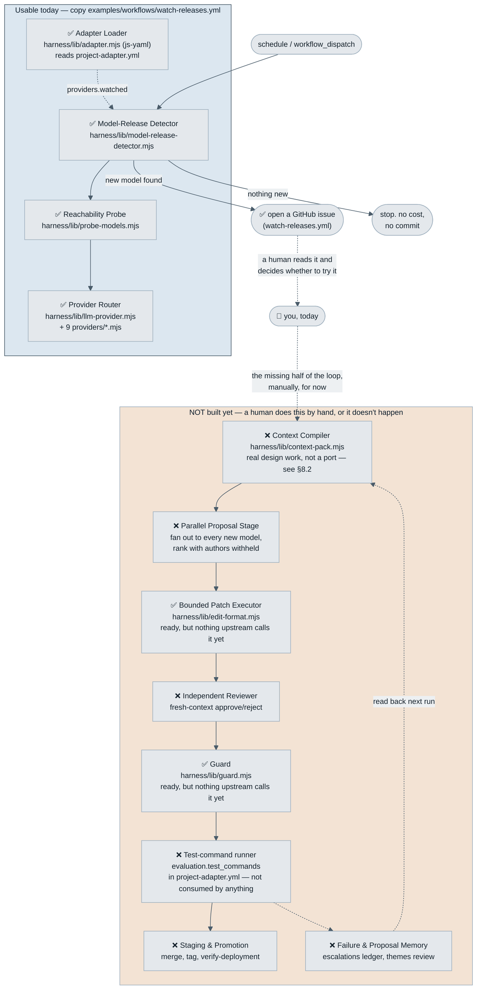

# Architecture — what's actually built, in pictures

This page exists because the other diagrams in this repository each answer a
different question, and none of them answers "what does *self_optimisation
itself* actually have working today" — which is the one a first-time visitor
usually wants. Read this page for that. Read `learning/diagrams/` for the
portable pattern you'd lift into another project. Read
`Portable-Harness-Design.md` §7 for the prose mapping between the two.

## The three diagram layers, and which one you want

| Layer | Where | Shows |
|---|---|---|
| **This repo's real status** | Below, on this page | What's actually built in `self_optimisation`, annotated ✅/🚧/❌ — new, drawn for this question specifically |
| **Portable pattern** | [`learning/diagrams/generic-loop.mmd`](learning/diagrams/generic-loop.mmd), `generic-guardrails.mmd`, `generic-context.mmd` — embedded and viewable in [`learning/02-blueprint.md`](learning/02-blueprint.md) and [`learning/05-guardrails-and-trust.md`](learning/05-guardrails-and-trust.md) | The abstract loop and guardrail layers, project-neutral — what you'd draw for *any* installation, including one that isn't this harness at all |
| **Reference implementation, concretely** | [`learning/diagrams/worked-example-run.mmd`](learning/diagrams/worked-example-run.mmd), `worked-example-harness.mmd` — embedded below since GitHub doesn't render a bare `.mmd` file as a picture | The same pattern as it actually runs in the reference implementation (real job names, real check counts, real token costs) — useful for seeing what the abstraction looks like once it's hit a real, live system |

## What's actually built here, today

**Read this diagram as an honest gap, not a roadmap with checkboxes filled
in.** The blue box is real, tested, and runnable via
`examples/workflows/watch-releases.yml` right now. The tan box is the rest
of the campaign lifecycle from the paper's §4 — most of it doesn't exist,
so a human currently plays the part of those nodes by hand, reading the
issue the detector opened and deciding what to do next. `edit-format.mjs`
and `guard.mjs` are the two exceptions inside the tan box: both fully built
and tested, both waiting on the orchestrator that would actually call them
in sequence. Nothing yet reads `evaluation.test_commands` from
`project-adapter.yml` either — the field exists in the schema, but no
component runs a project's tests on the harness's behalf.

`Portable-Harness-Design.md`'s Status table has the same information as
prose, kept in sync by hand — if the two ever disagree, trust whichever was
edited more recently and fix the other.

## The reference implementation, concretely

The abstract loop above, as it actually runs in the reference implementation
— real job names, real check counts. Two diagrams, embedded here because a
bare `.mmd` file renders as plain text on GitHub, not a picture (see
[`learning/diagrams/README.md`](learning/diagrams/README.md)'s "three
mechanical traps" for why sidecar files still exist despite that).

That is the reference implementation's real 7-job workflow — 18+
generations run against it, including the incidents `learning/03-failure-modes.md`
catalogs. Every stage in it that isn't already ✅ in this page's status
diagram above is genuinely unbuilt in `self_optimisation` yet.
