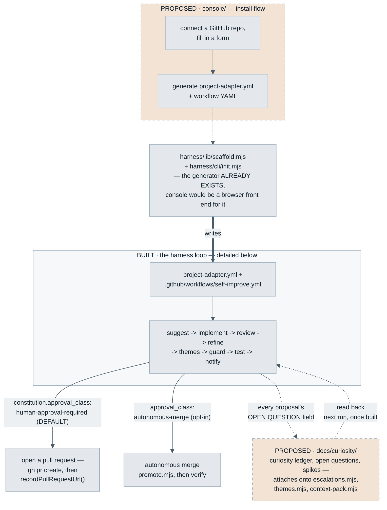
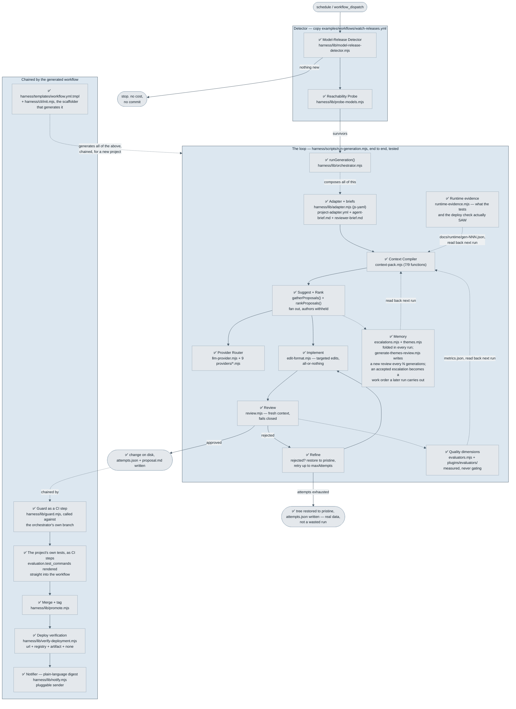
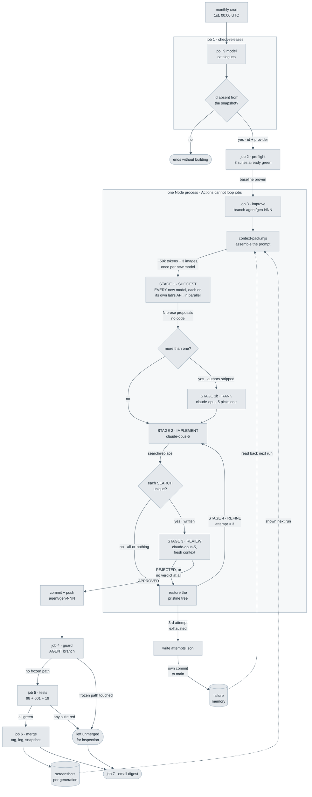
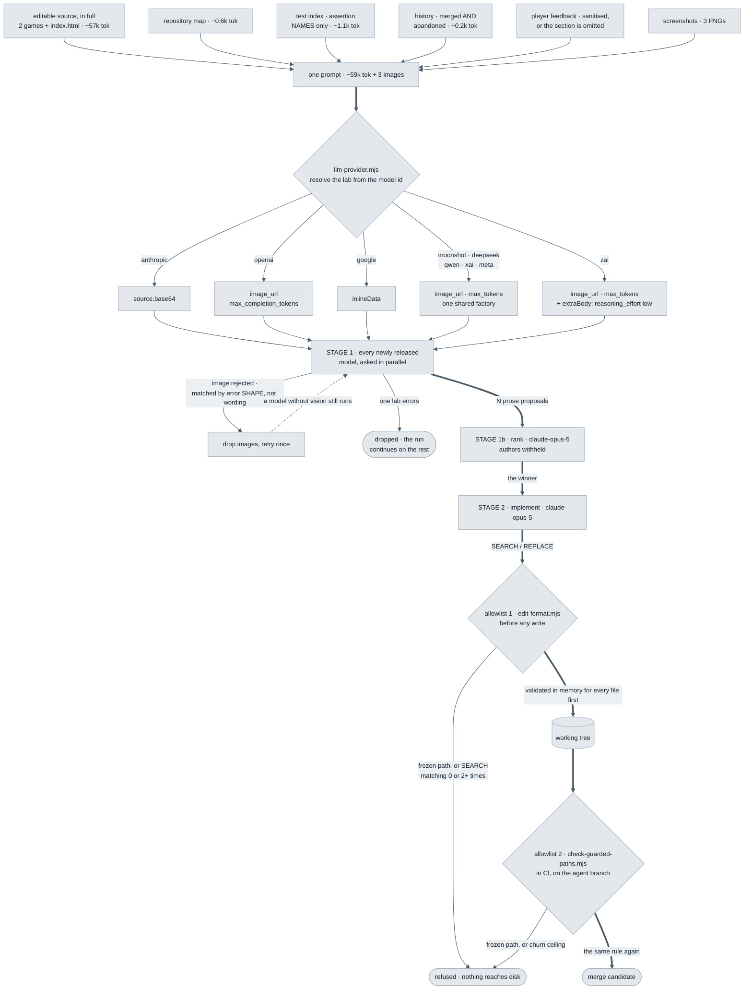

# Architecture — what's actually built, in pictures

This page exists because the other diagrams in this repository each answer a
different question, and none of them answers "what does *self_optimisation
itself* actually have working today" — which is the one a first-time visitor
usually wants. Read this page for that. Read `learning/diagrams/` for the
portable pattern you'd lift into another project. Read
`Portable-Harness-Design.md` §7 for the prose mapping between the two.

## The five diagram layers, and which one you want

| Layer | Where | Shows |
|---|---|---|
| **The whole project, today** | Below, on this page — new, added to answer "how do console/harness/curiosity relate" | Console + harness + curiosity as one picture, solid where built, dashed where proposed — the only diagram that spans all three |
| **This repo's real status (the harness alone)** | Below, on this page | What's actually built in the harness specifically, annotated ✅/🚧/❌ |
| **Portable pattern** | [`learning/diagrams/generic-loop.mmd`](learning/diagrams/generic-loop.mmd), `generic-guardrails.mmd`, `generic-context.mmd` — embedded and viewable in [`learning/02-blueprint.md`](learning/02-blueprint.md) and [`learning/05-guardrails-and-trust.md`](learning/05-guardrails-and-trust.md) | The abstract loop and guardrail layers, project-neutral — what you'd draw for *any* installation, including one that isn't this harness at all |
| **Reference implementation, concretely** | [`learning/diagrams/worked-example-run.mmd`](learning/diagrams/worked-example-run.mmd), `worked-example-harness.mmd` — both embedded below since GitHub doesn't render a bare `.mmd` file as a picture | The same pattern as it actually runs in the reference implementation (real job names, real check counts, real token costs) — useful for seeing what the abstraction looks like once it's hit a real, live system |
| **Proposed, not built** | [`learning/diagrams/proposed-curiosity-run.mmd`](learning/diagrams/proposed-curiosity-run.mmd), `proposed-curiosity-memory.mmd`, `proposed-curiosity-authorisation.mmd`, indexed at [`docs/curiosity/README.md`](docs/curiosity/README.md) | The curiosity design's own three diagrams — a second longitudinal pass, none of it built. Do not read as documentation of the harness. |

## The whole project, in one picture

Console, harness, and curiosity live at three different maturity levels, and
no other diagram in this repository shows them on the same page. Solid boxes
are real and running; dashed, warm-toned boxes are proposed and do not exist
yet — the same convention [`learning/diagrams/README.md`](learning/diagrams/README.md)
uses for the curiosity diagrams, applied here to the console too.

Two things this picture makes visible that no prose paragraph had said in
one place before: the console's real prerequisite (the generator) already
exists under a different name than its own design doc guessed
(`harness/lib/scaffold.mjs`, not a new `install.mjs`) — see console/DESIGN.md
§2.1 for the now-superseded original argument; and curiosity has exactly
three attachment points onto the loop, all additive, none of them requiring
the loop itself to change shape.

## What's actually built here, today

**The core loop is real as of this diagram's last edit.** Suggest →
implement → review → refine runs end to end via
`harness/scripts/run-generation.mjs`, against your own project's adapter
and brief files. Staging & promotion, deployment verification (all four
strategies now), and the notifier are real too, each a standalone tested
CLI — and now `harness/cli/init.mjs` + `harness/templates/workflow.yml.tmpl`
chain the loop, the guard, the tests, promotion, verification and
notification into one generated workflow for a new project, so nothing
below is a human running each script by hand anymore.

**Added 2026-09-02, not yet drawn above:** every model call is recorded
(`spend.mjs`) and a generation has a token cap; the fate of every pull
request is read back at the top of each cycle (`pull-requests.mjs`) and a
shipped generation can be reverted (`rollback.mjs`), both of which the next
prompt and the earned-ambition check read; the owner sets how ambitious a
run may be (`context.ambition`, `docs/Ambition-Control.md`); the rank seat
defaults to a different family than the implementer and a rotating model
can earn the implement seat (`seats.mjs`); a generated `REPORT.md` carries
the paper's metrics (`report.mjs`); campaign mode runs a generation on
models named by hand; the committed goal (`project.goal`) sits above the
brief and the reviewer judges against it; and a themes review may name
what it cannot tell (`UNKNOWN`). Each is a `harness/lib/` module with its
own test file. See `WORKPLAN.md` Tier 0 and Tier 5.

**Read this diagram as what's real, not a roadmap with checkboxes filled
in.** Every box is real: the detector via
`examples/workflows/watch-releases.yml`, and the loop via
`harness/scripts/run-generation.mjs` run directly — 34 tests against fake
model responses, plus `tests/e2e/full-loop.test.mjs`: two automated tests
that drive the whole chain — suggest → implement → review → guard → test →
promote (autonomous merge) → verify → notify — in the generated workflow's
real order, against a real git remote and a real child-process test run,
faking only the three model calls. One proves the happy path merges and the
digest correctly says so; the other proves an exhausted-attempts run merges
nothing and the digest correctly says that too. This automates what used to
be a one-off manual run: a real end-to-end pass against a temp project with
a real adapter and real brief files (no API key configured, which correctly
produced a `no-proposal` outcome rather than crashing on a wiring bug — see
`Portable-Harness-Design.md`'s Bucket B table for that verification in
detail) — the manual run stays true as a record of what was checked before
the automated version existed. `check-guarded-paths.mjs` runs standalone against a real git diff;
`promote.mjs` (merge + tag) was verified against a real two-repo git setup
including an actual merge conflict; `verify-deployment.mjs` now implements
all four `deployment.verify_strategy` values — `url` (poll a live site,
compare canonicalised content, timeout), `registry` (poll npm/PyPI/NuGet/
Maven Central for the tagged version — four real, differently-shaped APIs,
not one faked shared shape), `artifact` (build, confirm the output path
exists, optionally smoke-run it), and `none`; `notify.mjs` sends a
plain-language digest with a reliable terse fallback, delivery behind a
`registerSender()` registry so SendGrid is one registered sender, not a
hardcoded dependency. What used to be "each piece real but nothing chains
them" is now chained: `harness/templates/workflow.yml.tmpl` renders detect
-> probe -> preflight -> improve -> themes -> guard -> test -> promote -> verify ->
notify as one sequential-steps GitHub Actions job (Actions can't loop or
dynamically branch jobs — see the reference-implementation diagram below
for what that constrains), and `harness/cli/init.mjs` asks the
Portable-Harness-Design.md §6 questions and writes that workflow plus a
filled `project-adapter.yml`, brief-template copies, and a short install
README for a new project — verified against a real, fresh git repo end to
end, and via `tests/lib/scaffold.test.mjs` parsing every strategy
combination's generated YAML back with `js-yaml` to confirm it's valid.

**The merge model, reconciled (was the known gap here):** the template used
to render only autonomous merge. It now renders one of two paths, chosen at
scaffold time from `constitution.approval_class` — a field that until this
change was parsed by nothing.

- **`human-approval-required`** is the default, and the fallback for any
  unrecognised value. Every gate runs against the agent branch; then the
  workflow opens a pull request with `gh pr create` and records its URL
  back into that generation's `attempts.json` via
  `harness/scripts/record-pull-request.mjs`. It runs no deployment
  verification, because nothing is deployed until a person merges.
- **`autonomous-merge`** is the opt-in: `promote.mjs` merges and tags, then
  `verify-deployment.mjs` checks what that shipped.

Exactly one path is written into the generated file, so which merge model a
repository got is answerable by reading its workflow rather than by
cross-referencing an adapter field against harness code. Unrecognised values
fail closed to the pull-request path (`harness/lib/adapter.mjs`'s
`normalizeApprovalClass()`), because a typo must never be the reason a
project starts merging its own changes unattended — `console/DESIGN.md`
§Step 7: "defaulting a non-technical user into autonomous merge is the
single worst decision this console could make."

The `schedule:` block is likewise now optional (`console/DESIGN.md` §Step 9's
two-phase onboarding): rendered by default for `init`, omitted — leaving a
`workflow_dispatch`-only workflow and a commented cron to add later — when
the installer asks for it. Until then there is no cron in the repository to
fire, which makes "the schedule stays off until a rehearsal passes" a fact
about the file rather than a promise about the process.

`Portable-Harness-Design.md`'s Status table has the same information as
prose, kept in sync by hand — if the two ever disagree, trust whichever was
edited more recently and fix the other.

## The reference implementation, concretely

The abstract loop above, as it actually runs in the reference implementation
— real job names, real check counts. Two diagrams, embedded here because a
bare `.mmd` file renders as plain text on GitHub, not a picture (see
[`learning/diagrams/README.md`](learning/diagrams/README.md)'s "three
mechanical traps" for why sidecar files still exist despite that). Both are
byte-for-byte the same structure as their `learning/diagrams/` sidecars —
keep it that way; a hand-edited copy here that quietly drifts from the
sidecar is the exact mistake this note exists to prevent.

That is the reference implementation's real 7-job workflow — 18+
generations run against it, including the incidents `learning/03-failure-modes.md`
catalogs. Every stage in it that isn't already ✅ in this page's status
diagram above is genuinely unbuilt in `self_optimisation` yet.

The harness diagram — the same reference implementation, but token flow and
per-provider dispatch instead of the CI job sequence:

Both diagrams describe the reference implementation, carrotgame — the check
counts (98+601+19), token estimate (~59k), and provider-dispatch table are
its numbers, not `self_optimisation`'s own.
