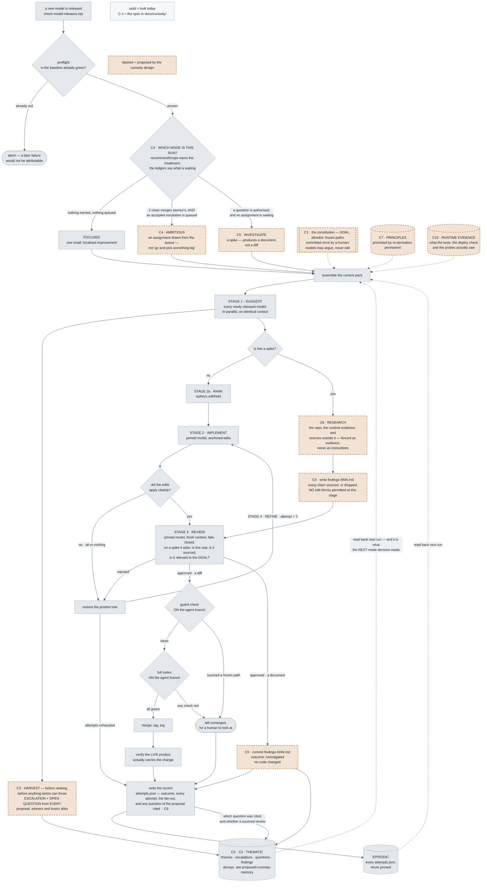

# Curiosity Engine — Design Document

A second longitudinal pass over the generation record that asks the
question the themes review does not: not *"what pattern is repeating"* but
*"what does this repository still not understand about itself, and which of
those gaps is most likely to hide an improvement."*

**Status: proposal.** Nothing in this document is built. It is written to
the same standard as [`Portable-Harness-Design.md`](../Portable-Harness-Design.md)
and [`console/DESIGN.md`](../console/DESIGN.md): every claim about what the
harness does today is checked against the code, and every field is marked
**LIVE** (something reads it) or **RESERVED** (nothing does, yet).

Read §2 before §4. The idea is good and the framing in §1.1 is the right
framing, but four things in the originating notes would produce a
plausible-looking mechanism that measures nothing, and this repository has
already been burned once by exactly that failure (§2.1).

---

## 0. The whole thing, end to end

Three diagrams live in [`learning/diagrams/`](../learning/diagrams/), in the
same Mermaid source form as the five that describe the harness itself.
**Solid nodes are built today; dashed, warm-toned nodes are proposed by this
document.** Reading the first one is the fastest way to see what actually
changes about a run.

| # | Diagram | What it answers |
|---|---|---|
| **D1** | [`proposed-curiosity-run.mmd`](../learning/diagrams/proposed-curiosity-run.mmd) | One lap, end to end. Where the three run modes are chosen, where questions are harvested, and what a spike does differently. Embedded below. |
| **D2** | [`proposed-curiosity-memory.mmd`](../learning/diagrams/proposed-curiosity-memory.mmd) | What happens *between* laps — the three tiers of §5.5, promotion by re-derivation, and what gets forgotten. |
| **D3** | [`proposed-curiosity-authorisation.mmd`](../learning/diagrams/proposed-curiosity-authorisation.mmd) | What authorises what — §2.5 and §4.5 drawn: looking is cheap, committing is expensive, and silence stops being scored as rejection. |

### The components, and where each is specified

Every node in those diagrams carries a **`C n`** prefix naming its
implementation spec in [`curiosity/`](curiosity/) — build instructions, not
argument: the file it touches, the data shape, the interface, how it fails,
and the tests to write. The full index with dependencies and phases is
[`curiosity/README.md`](curiosity/README.md).

| # | Component | This document | Spec |
|---|---|---|---|
| C1 | Committed goal | §5.2 | [C1-committed-goal.md](curiosity/C1-committed-goal.md) |
| C2 | Themes review CLI + `UNKNOWN` | §4 stage A | [C2-themes-review-cli.md](curiosity/C2-themes-review-cli.md) |
| C3 | Curiosity ledger | §4 stage B, §3.1 | [C3-curiosity-ledger.md](curiosity/C3-curiosity-ledger.md) |
| C4 | Run-mode selector | §2.3, §4.5 | [C4-run-mode-selector.md](curiosity/C4-run-mode-selector.md) |
| C5 | The spike | §4 stage C, §2.4 | [C5-the-spike.md](curiosity/C5-the-spike.md) |
| C6 | External research | §4 stage C | [C6-external-research.md](curiosity/C6-external-research.md) |
| C7 | Memory consolidation | §5.5 | [C7-memory-consolidation.md](curiosity/C7-memory-consolidation.md) |
| C8 | Escalation follow-through | §2.5, §8 | [C8-escalation-follow-through.md](curiosity/C8-escalation-follow-through.md) |
| C9 | Retrospective scoring | §5.3, §6 | [C9-retrospective-scoring.md](curiosity/C9-retrospective-scoring.md) |
| C10 | Runtime evidence | §3.5 | [C10-runtime-evidence.md](curiosity/C10-runtime-evidence.md) |

**Two can be built today**, against the harness as it stands, independent of
everything else: **C8** (the smallest and highest-value — an accepted
escalation currently schedules no work) and **C10** (pure context-pack work
that improves every proposal, curiosity or not).

**And none of it is required for a run to happen.** A repository with no
history has no curiosity: every section drops when its input is absent, the
first ten generations are the ordinary loop unchanged, and the first
`UNKNOWN` question cannot exist before the first themes review. The
generation-by-generation timeline — including the two things that are *not*
deferred — is in
[`curiosity/README.md` §"Cold start"](curiosity/README.md#cold-start-the-first-runs-must-work-with-none-of-this).

The thing worth noticing in the first diagram is how little is new. There is
no second pipeline: one trigger, one context pack, one review gate, one
guard, one merge. Curiosity adds **a third run mode**, **a harvest that was
already happening for escalations**, and **an outcome that writes a document
instead of a diff**. Everything else is the loop that already runs.



*One lap with curiosity woven in. The three modes at the top are the whole
structural change; the spike branch on the right rejoins the ordinary review
gate rather than routing around it.*

---

## 1. The idea, restated

> Stop treating curiosity as a personality trait and define it as a
> computable drive to seek information expected to improve the agent's model
> of the world. The harness currently asks *"how can I improve this
> repository?"* A curiosity engine asks *"what don't I currently understand
> about this repository that, if understood, has the highest probability of
> revealing an improvement?"*

That is the correct reframe, and it matters here more than it would in most
codebases, because of [principle 21](../learning/01-principles.md#21-constraints-never-expire-hints-should).
"Be curious" written into an agent brief is a **hint** — it suggests how to
think, and a stronger model in the seat next month does not need it and is
mildly constrained by it. A curiosity *mechanism* that maintains state
across generations is not a hint; it is durable context the model could not
reconstruct from its own prompt, in the same category as the escalation
ledger and the themes review. Hints decay. Mechanisms that carry state
across a discontinuity do not.

### 1.1 Why this harness is an unusually good host for it

Three properties, none of which are typical:

1. **The loop is already discontinuous and already amnesiac.** One
   generation per model release, a different model in the suggesting seat
   each time, no memory except what is written to disk. Everything durable
   already has to be an artifact. A curiosity engine has no choice but to
   be built the right way here — as a file, not as an in-process loop.
2. **The fan-out asks several models from several labs the same question
   with the same context.** That is a population, and a population gives
   you a measured disagreement rather than a self-report. §3.1 argues this
   is the single most valuable thing in the design.
3. **A per-change reviewer and a per-ten-change themes reviewer already
   exist and are already wired.** The insertion point is a seam that is
   built, tested and load-bearing, not a new subsystem.

---

## 2. Five corrections before any of this gets built

### 2.1 The six-term score is one term wearing five hats

The proposed objective:

```
Curiosity(x) = α·Novelty + β·Uncertainty + γ·InformationGain
             + δ·Surprise + ε·Usefulness − λ·Cost
```

Two problems, and the second is the serious one.

**The terms are not independent.** In the Bayesian formulation this is
reaching for, expected information gain *is* the principled combination of
novelty, uncertainty and surprise — the expected KL divergence between
prior and posterior already contains all three. Adding them linearly
double-counts, and you are left with six free parameters and no data to fit
them against. On day one every weight is a guess, and there is no gradient
that will ever correct it.

**The scores would be LLM self-reports on an unanchored scale.** In the
worked example, `Profile slow requests` scores `.6 / .8 / .9 / .3 → .72`.
Where do those numbers come from? A model asked to rate the expected
information gain of its own question will return a number that looks
calibrated and is not. The output is then a ranking whose apparent
precision far exceeds its evidence, and every downstream consumer treats
`.72` as if it were measured.

This repository has a scar on precisely this pattern.
[`learning/07-whats-actually-new.md` §3](../learning/07-whats-actually-new.md)
records the `readingLevel` scorecard dimension: it scored Flesch-Kincaid
grade over `document.body.innerText`, which is invisible to a canvas game,
so it rewarded simplifying the About page over fixing anything a child
actually sees. Score went 44 → 79 on unchanged code once the metric was
replaced. [Principle 22b](../learning/01-principles.md#22b-a-fitness-function-measures-what-it-can-reach-not-what-matters--and-the-loop-will-optimise-the-gap)
is the general form: *a fitness function measures what it can reach, not
what matters, and the loop will optimise the gap.*

A curiosity score is a fitness function over questions. It will be gamed the
same way. A model rewarded for "uncertainty reduction" learns to ask
questions it is genuinely uncertain about and which do not matter — and
unanchored self-scoring makes that failure invisible, because the numbers
will look fine.

**Recommendation.** Collapse to two terms, both of which this harness can
actually observe:

| Term | Why it survives |
|---|---|
| **Cost** | Genuinely measurable today — tokens, wall-clock, API spend, and whether answering it fits inside one generation's edit budget. Keep `−λ·Cost`; it is the one honest term in the original formula. |
| **Expected value of the answer** | Kept, but scored **retrospectively as well as prospectively**, and the retrospective score is the one that counts. |

The retrospective half is the whole trick, and §5 spells it out. A question
opened at generation N can be *checked* at generation N+k against
`docs/generations/gen-NNN/attempts.json`: did any proposal cite it, did a
proposal citing it survive review, did it ship? That produces real labels.
Real labels are the difference between a dashboard and a fitness function —
the exact distinction `07-whats-actually-new.md` says this project is still
on the wrong side of.

Keep the prospective score as a **tiebreak within one review's output**, not
as a cross-generation quantity, and never store it as if it were
comparable across reviews. A rank is defensible. A `.72` is not.

### 2.2 The recursive step happens between generations, not inside one

The notes' worked example is a single debugging session:

```
observe → detect uncertainty → generate questions → estimate gain
        → investigate → learn → update beliefs → generate new questions
```

That is a within-task loop, and it does not describe this harness. Here,
"investigate" is a whole generation: a proposal, an implementation, a
review, possibly three refinement attempts, a PR, a merge. The recursion
period is *weeks*, and the agent that generates the question is not the
agent that answers it and is not the agent that reads the answer.

That is not a weakness — it is what makes the engine worth building rather
than prompting. But it forces the design:

- The knowledge state **must** be a file on disk with a lifecycle, in the
  shape of [`docs/escalations/ledger.json`](../harness/lib/escalations.mjs),
  not a variable in a process.
- "Update beliefs" is not a step the engine performs. It is a step the
  engine *observes having happened* by re-reading the generation record.
- Every question must survive being read by a model that has never seen the
  model that wrote it — the same constraint that shaped `buildThemesBrief()`
  and `buildEscalationBrief()`.

### 2.3 It should not sit "one level above" the harness

The notes propose the engine as a supervisory layer above proposal
generation, evaluation and memory. That is the architecturally expensive
version: a new stage, a new cadence, a new model call, new config, new
failure modes, and a new thing that can be wrong about a repository it
reads through a keyhole.

The cheap version gets most of the value, because **the themes review is
already doing the expensive half of the work.** It already:

- reads N generations of record in bulk (`buildGenerationHistory()`,
  [`context-pack.mjs:249`](../harness/lib/context-pack.mjs));
- asks a fresh model a question no single generation's review can answer;
- writes one JSON file per review;
- is read back into every subsequent suggestion prompt through
  `buildThemesBrief()` → `context.themes` →
  [`orchestrator.mjs:251`](../harness/lib/orchestrator.mjs)'s `section()`.

Curiosity is *the same read, a different question*. `NOTICED` is
association. `MEANS` is abstraction. What is missing is the third move:
**the frontier of the abstraction** — what the principle implies we do not
yet know. Adding it costs one prompt field, one parse rule and one prompt
section. It costs no new cadence, no new model call and no new config.

**But be honest about what piggybacking cannot do.** A theme is by
construction a thing that *recurred* — it is found where the evidence is
dense. Curiosity should point where the evidence is *sparse*. A themes-only
curiosity pass structurally looks where the light is, and it is capped at
the 2–4 themes the parser allows. That is a real ceiling, and it is why §4
proposes two stages rather than one: stage A rides the themes review, stage
B harvests questions from the fan-out, where sparse-evidence questions
actually come from.

### 2.4 Question-generation is safe. Investigation is an action space

This is the correction that must not be traded away.

Curiosity is a drive to *investigate*, and investigation wants capabilities
this harness deliberately withholds: running arbitrary code, reading
outside `constitution.allowed_paths`, reaching the network, probing
production. The entire governance story — the allowlist in
[`edit-format.mjs`](../harness/lib/edit-format.mjs), the guard in CI, a
review that [fails closed](../learning/01-principles.md#14-the-safety-gate-fails-closed-helpers-fail-safe),
[principle 10](../learning/01-principles.md#10-an-agent-that-can-edit-its-own-rules-has-no-rules)
— rests on a narrow action space.

So: **v1 generates questions and nothing else.** It gets no tools, no
execution, no network. Investigation happens through the channel that
already has four gates on it — a curiosity-driven generation is an ordinary
generation whose proposed change happens to be instrumentation, and it is
reviewed, tested and merged exactly like any other. A "spike" is not a new
privilege; it is a normal edit that adds a counter.

If a later version wants an agent that *executes* experiments to reduce its
own uncertainty, that is a materially different safety proposition, needs
its own gate, and does not belong in the same document as this one.

### 2.5 The consensus gate selects for obviousness, and silence is its veto

The natural instinct is to gate a research spike behind the escalation
ledger's existing bar — three distinct models across two labs. Two reasons
that is wrong as stated, and one of them is a finding about the code rather
than about the idea.

**There is no veto today, and the real blocker is worse than one.**
`consensusOf()` ([`escalations.mjs:194`](../harness/lib/escalations.mjs))
counts `supporters` only. Dissenters are recorded, rendered into the next
model's brief, and included in the owner notification — but they do not
subtract and they do not block. An entry two models argued against can
still reach the bar.

What actually blocks a lone idea is that **the other models never mention
it**, and the mechanism scores that identically to rejection. Silence is
not disagreement — a model that did not back an escalation may never have
considered it. Today, inattention and judgement are the same number.

**And a consensus bar is a majority filter, so it selects for
obviousness.** The most valuable ambitious idea is close to definitionally
the one fewest models thought of. Requiring 3-of-N agreement filters out
exactly the originality the ambitious track exists to capture. This is the
argument novelty search (Lehman & Stanley) makes against pure
objective-based selection: the objective kills the stepping stones.

Four corrections, in value order:

1. **Split "look" from "commit."** A spike is cheap; an implementation is
   expensive. **One model with a high-conviction question earns an
   investigation; three models agreeing earns an implementation.** This
   dissolves most of the problem: the lone ambitious model gets its hunch
   documented and grounded, and the *findings* are what the other models
   then react to. It converts "do you agree with this hunch?" — a bad
   question for a consensus gate — into "do you agree with this evidence?"
2. **Ask explicitly rather than waiting for volunteers.** An entry stuck
   below the bar for N generations should be re-surfaced to the next
   fan-out with a direct question: *one model raised this, nobody has
   engaged with it — agree, disagree, or irrelevant?* That converts
   silence into a judgement, and makes "nobody backed it" mean something.
3. **Set the bar by reversibility, not by size.** One global threshold
   treats "add a flag" and "change the data model" alike. Additive,
   flagged or new-file changes should clear lower than structural ones.
4. **Send the minority report to the owner.** The digest notifies on
   consensus only. High-conviction unbacked items are precisely what a
   human spots faster than three models will.

One free by-product: a recorded dissent that later proves wrong is a
retrospective calibration label on that model. *"Two models said this would
break; it shipped and did not"* is a real signal about the dissenters, and
the ledger already stores everything needed to compute it.

---

## 3. The signal this harness already has and currently discards

Before adding a scoring function, spend the signal already on disk. Three
of these are free.

### 3.1 Cross-model disagreement is measured uncertainty, not a self-report

**This is the strongest idea available here, and it is close to unique to
this harness.**

The fan-out asks 2–5 models from different labs the same question over
identical context. `recordEscalations()`
([`orchestrator.mjs:662`](../harness/lib/orchestrator.mjs), called at
line 852) already harvests a field from **every** asked model, including
the ones whose proposals lost the ranking — with the comment that a losing
proposal's opinion about the brief is worth exactly as much as the
winner's. Consensus is then counted across *distinct models* and *distinct
labs*, deliberately, because "three agreeing models from one family is a
shared prior; three across two labs is a signal"
([`escalations.mjs:34`](../harness/lib/escalations.mjs)).

Apply that machinery to knowledge instead of governance and you get
something the intrinsic-motivation literature cannot easily produce: when
three frontier models from two labs, reading the same context
independently, all say *"I cannot tell from this why X behaves the way it
does"*, that is **an estimate of uncertainty in the population of frontier
models about this specific repository.** It is not a model rating its own
confidence. It is agreement across independently-trained systems, and it is
exactly the quantity α·Novelty + β·Uncertainty was reaching for and could
not reach.

It is also cheap: the harvest path, the consensus counter, the
open/supported/dissented lifecycle, the "flag once, never re-notify"
transition and the prompt renderer all exist and are tested.

### 3.2 A rejected attempt is a recorded prediction error

`writeAttemptRecord()` stores every attempt and its outcome —
`edits-did-not-apply`, `rejected-by-review`, `abandoned`, `crashed`, each
with a `detail` string. In the curiosity-driven-RL framing, prediction
error *is* the reward signal, and a rejection is a clean one: a proposing
model predicted a change was good, and an independent reviewer with fresh
context disagreed. Something in the proposer's model of the repository was
wrong, the record says so, and today nothing reads it as anything other
than history to avoid repeating.

The `abandoned` and `crashed` outcomes are the richest material in the
repository for this pass and are currently its least-read files.

### 3.3 `BRIEF FEEDBACK` is already asking models what the harness is blind to

The suggestion format requires it
([`orchestrator.mjs:152`](../harness/lib/orchestrator.mjs)): *"which parts
of the brief genuinely helped? Which constrained you for no good reason?
What would you delete?"* It is collected per model, from every model asked
([`orchestrator.mjs:870`](../harness/lib/orchestrator.mjs)), stored in
`attempts.json`, and surfaced to a human in the digest.

No automated pass ever reads it back. A model saying *"the brief told me
the scorecard exists but I could not see what it measures"* is a curiosity
question already written down in plain English.

### 3.4 Losing proposals are discarded — and that is where sparse-evidence questions live

`07-whats-actually-new.md` §3 already flags this: *"we generate N candidates
and discard N−1."* Confirmed in code — only the winner's text reaches
`proposal.md`; the losers survive as an id in `fanOut.proposed`, their
brief feedback, and their escalation fields. Their actual argument is gone.

For improvement selection that is a defensible trade (you cannot implement
five changes). For curiosity it is a straight loss: **the four rejected
proposals are four different reads of the same repository**, and where they
diverge is precisely where the repository is ambiguous. Harvesting one
curiosity field from every proposal costs nothing extra — the fan-out has
already been paid for.

### 3.5 Runtime evidence — the one thing worth borrowing from SIA

[hexo-ai/sia](https://github.com/hexo-ai/sia) runs a meta agent → task
agent → task environment → improvement agent loop, and the edge it holds
over this harness is not the meta agent (this project deliberately keeps
the brief human-written and frozen, and that trade is defensible). It is
`agent_execution_log.json`: the improvement agent reads **what actually
happened at runtime**, not a diff and a verdict.

This harness's improvement signal is "review approved, tests green" — a
judgement about code, made by reading code. The analogue worth borrowing is
not an agent trace (the suggesting model here is one-shot); it is **runtime
evidence about the product**: what the tests actually exercised, what
`verify-deployment.mjs` saw, the scorecard probe's raw output rather than
its score.

This is the same gap the webfont incident exposed — 239 checks green, a
thirteen-second first paint. A curiosity engine reading only source will
ask questions about source. Curiosity grounded in a runtime log asks about
behaviour, which is where the defects that survive every gate actually
live.

---

## 4. The design

Two stages, deliberately ordered so the cheap one ships and produces
evidence before the expensive one is committed to.

### Stage A — a third field on the themes review

**One new prompt field, one new parse rule, one new prompt section. No new
files, no new cadence, no new model call.**

The themes review currently produces, per theme:

```
NOTICED: <the association — what keeps co-occurring, citing generations>
MEANS:   <the abstraction — the principle that explains why>
```

Add:

```
UNKNOWN: <the question this principle exposes and does not answer: what
          would you have to find out to know whether it holds, or what
          it implies that no generation has tested yet>
```

Changes required, all in files that exist:

| File | Change |
|---|---|
| [`harness/lib/generate-themes.mjs`](../harness/lib/generate-themes.mjs) | `buildThemesSystemPrompt()` gains the third field and its instruction; `parseThemesResponse()` gains an `UNKNOWN` capture and a minimum-length check, in the same style as the existing `NOTICED`/`MEANS` guards. Fail closed on a malformed field, consistent with this module's stated posture (*a themes review is permanent standing context, so a bad one is worse than none*). |
| [`harness/lib/themes.mjs`](../harness/lib/themes.mjs) | `buildThemesBrief()` renders it. Keep it a **separate section** from the themes prose, not a trailing sentence — a question needs to read as an invitation, not as a footnote to a lesson. |
| [`harness/lib/orchestrator.mjs`](../harness/lib/orchestrator.mjs) | One more `section()` call at line 251, e.g. *"Open questions this project has not answered."* |

`UNKNOWN` should be optional per theme, not required. A theme whose
principle is genuinely settled has no live question attached, and forcing
one produces exactly the padded, plausible-sounding question this whole
design is trying to avoid — the same reasoning already applied to the theme
count (*"if you cannot find a genuine one, it is better to return fewer than
to pad the count"*).

**Prerequisite, and it is a real one.** `generate-themes.mjs` is the prompt
and the parser. **No CLI calls a model with them** — `generate-themes-review.mjs`
was deliberately not ported, because it needs generation history as input
and that only exists once real `docs/generations/gen-NNN/` records
accumulate ([`Portable-Harness-Design.md` §3, Bucket B table](../Portable-Harness-Design.md)).
`memory.themes_review.cadence_generations` is parsed by
[`adapter.mjs:157`](../harness/lib/adapter.mjs) and unit-tested, and
**nothing reads it** — it is RESERVED, and `adapter.mjs:141` says so in a
comment.

So stage A's actual first task is the one the repository already knows it
owes: write the themes-review CLI and have something honour the cadence.
Curiosity is a two-line addition to a pass that does not yet run. Building
the curiosity half first would be writing a consumer for data nothing
produces — the fiction this repository has twice refused to write.

### Stage B — the curiosity ledger

Once stage A has run at a few cadence boundaries and there is evidence the
questions are worth anything, harvest from the fan-out.

**A new response field on the suggestion stage**, alongside the escalation
fields it already requires:

```
OPEN QUESTION: <REQUIRED, and "none" is a good answer. One thing about this
        repository you could not determine from the context you were given,
        where knowing the answer would plausibly change which improvement
        is worth making. Not a to-do. A gap in what is knowable from here.>
QUESTION SUPPORT: <none, or the id(s) of open questions you independently
        hit the same wall on, and what you could not determine.>
QUESTION ANSWER: <none, or the id of an open question this generation's
        work actually answers, and what the answer is.>
```

**A ledger at `docs/curiosity/ledger.json`**, structurally near-identical to
the escalation ledger — because the lifecycle is genuinely the same shape,
not because reuse is tidy:

```jsonc
{
  "version": 1,
  "consensus": { "models": 3, "labs": 2 },
  "questions": [{
    "id": "q-001",
    "slug": "why-does-review-reject-timing-changes",
    "question": "...",
    "status": "open",           // open | corroborated | answered | retired
    "opened":     { "generation": "014", "model": "...", "provider": "..." },
    "supporters": [ /* distinct models across distinct labs, as escalations.mjs counts them */ ],
    "answered":   null,         // { generation, by, answer } once a generation resolves it
    "citedBy":    [],           // generations whose winning proposal named this id — the retrospective label
    "retired":    null          // { generation, reason: "no generation touched it in N" }
  }]
}
```

Four differences from the escalation ledger, each load-bearing:

1. **Nobody is interrupted.** An escalation crossing consensus flags a human
   ([`escalations.mjs`](../harness/lib/escalations.mjs)'s `flagged`
   transition, then `send-escalation-notice.mjs`). A corroborated question
   changes nothing except its prominence in the next prompt. Curiosity is
   not a governance queue and must never become another notification
   channel.
2. **Questions can be answered by the loop itself,** which escalations
   cannot — an escalation is settled only by a human. `QUESTION ANSWER` is
   how the "update beliefs" step of §2.2's cycle actually gets recorded.
3. **Questions expire; escalations never do.** A question no generation
   cites for N generations is retired with a reason. This is
   [principle 21](../learning/01-principles.md#21-constraints-never-expire-hints-should)
   applied exactly: an open question is a hint about where to look, and
   hints must be deletable. Without expiry the ledger fills with plausible
   questions nobody wanted and the prompt section degrades into noise —
   which is the failure mode `context-pack.mjs`'s append-only-marker guard
   exists to prevent elsewhere.
4. **Harvest before ranking, like escalations.** The
   [`orchestrator.mjs:852`](../harness/lib/orchestrator.mjs) call site is
   deliberately placed before ranking and before anything that can throw,
   so an abandoned generation still contributes. A question from a losing
   proposal is worth as much as one from the winner — arguably more, since
   §3.4 is where divergent reads live. Use the same seam.

**And one addition to the record**: when a proposal cites a question id,
`writeAttemptRecord()` stores it. That is the label §5 needs, and it costs
one field.

### Stage C — the spike: a generation that produces a document instead of a diff

The originating notes propose a cycle of *generate questions (3) → estimate
information gain → investigate → document learnings → suggest*, and note
that investigation needs to reach outside the repository rather than only
reasoning over its own source. Both are right. The realisation that makes
them cheap is that **this is not a second pipeline — it is one new outcome
type on the pipeline that already exists.**

`runGeneration()` returns `approved`, `abandoned`, `no-proposal` or
`crashed`. Add:

```
outcome: 'investigated'   // wrote docs/curiosity/findings-NNN.md, changed no code
```

Everything else is unchanged: same cost, same reviewer, same
`attempts.json` record, same PR. The reviewer's question differs but its
posture does not — *is this a real finding, is it sourced, is it relevant
to the stated goal?* — and it still
[fails closed](../learning/01-principles.md#14-the-safety-gate-fails-closed-helpers-fail-safe).

The suggestion a spike produces does **not** ship from the spike. It goes
into the next ordinary generation and is implemented, reviewed and tested
like anything else. Curiosity never bypasses a gate; it only decides what
the gates are pointed at.

**Three questions, capped.** Forced scarcity, for the reason the themes
parser already caps at four: an open list produces padding, and padding is
indistinguishable from insight until it wastes a generation.

**Reaching outside the repository, and the one hard rule.** A question like
*"is there a better architectural pattern for this"* is answerable from the
literature and not from `buildSourceBundle()`'s output, so a spike that
cannot search is crippled. But search results are text a stranger wrote,
entering a pipeline that ends in a commit —
[principle 19](../learning/01-principles.md#19-anything-a-stranger-typed-is-data-not-instructions)
exactly, with a higher stake than player feedback ever had. So:

- The research pass writes `findings-NNN.md` with **sources cited**, and
  produces no diff. It is not permitted to emit edit blocks; the edit-format
  parser should reject them outright at this stage rather than ignore them.
- A **separate, later call** reads that file as context, fenced in the same
  hostile-input envelope player feedback already gets.
- **Uncited findings are dropped, not summarised.** Grounding is the entire
  point of reaching outside; an unverifiable claim is worse than silence,
  and [principle 18](../learning/01-principles.md#18-never-claim-data-you-did-not-supply)
  says the section disappears rather than describing data that is not there.
- Fetch, strip, truncate and cap exactly as the feedback path does. The
  downstream gates are the real backstop; this is the cheap first one.

---

## 4.5 What authorises a spike

§2.5's first correction, stated as a rule:

| Action | Bar |
|---|---|
| Open a question | Any model, any run. Free. |
| **Run a spike** (spend a generation on `investigated`) | One model's high-conviction question, **or** any question with corroboration ≥ 2. Not the full consensus bar. |
| Implement an ambitious change | The existing bar — 3 distinct models, 2 labs — **plus** a human accepting it. |
| Change a frozen rule | Unchanged. Human only, forever. |

The asymmetry is the design. Looking is cheap and should be easy to
authorise; committing is expensive and should stay hard.

---

## 5. Scoring, honestly

### 5.1 The product form, and what survives of it

A later revision of the originating notes restates the objective as a
**product** rather than a sum:

```
Curiosity(x) = Novelty · Uncertainty · InformationGain · Surprise · Usefulness
               ─────────────────────────────────────────────────────────────
                                        Cost
```

That change is not cosmetic, and it buys one genuinely correct property the
sum did not have: **any zero term zeroes the result.** Under the sum, a
fascinating, novel, surprising question about something that does not matter
still scored mid-table, because high novelty could paper over zero
usefulness. Under the product it scores zero, which is the right answer.

It also makes the correlation problem worse. Multiplying four terms that
measure roughly the same latent quantity (§2.1) compounds the correlation
rather than averaging it out, and the dynamic range collapses — four terms
at 0.5 give 0.06. The ranking then turns on whichever term happened to be
scored lowest, which is the least reliable number in the set.

**The reduction that keeps the product's semantics and drops its
arithmetic: filter, then rank.**

| Term | Role |
|---|---|
| `Usefulness` | **Filter.** Is this question relevant to the stated goal at all? Zero is allowed and means "drop it." |
| `Cost` | **Filter.** Can one generation afford to answer it? Zero is allowed. |
| `Novelty · Uncertainty · InformationGain · Surprise` | **One ranked dimension.** Not four numbers. Cross-model corroboration (§3.1) is what measures it. |

### 5.2 `Usefulness` only became definable when the goal did

Worth stating explicitly, because it is the hinge between this document and
the goal-setting work it depends on. In the original formulation
`ε·Usefulness` had no referent: useful *toward what*? A harness whose
success signal is "tests pass and a reviewer approved" cannot answer that,
which is why §2.1 could not rescue the term.

Once the user commits to a goal at install time — and once that goal is
frozen in the constitution rather than written into the brief — usefulness
becomes **proximity to the stated goal**, which a reviewer can judge and a
retrospective pass can score. The goal-setting feature and the missing
fitness function are the same feature, and this is the term that proves it.

This is the strongest argument for sequencing the goal first. Without it,
two of the six terms are undefinable and the other four are one term.

### 5.3 The three scores

Do not ship the six-term formula. Ship this:

**Prospective (cheap, weak, used only to order one review's output).** Rank
questions, do not score them. Ordering is what a ranker can defensibly
produce — the harness already trusts a model to rank proposals
(`rankProposals()`) and already handles an unparseable ranking by
[failing safe](../learning/01-principles.md#14-the-safety-gate-fails-closed-helpers-fail-safe)
to the first entry. Reuse that posture. Store the rank, not a decimal.

**Corroborative (free, strong).** Distinct models and distinct labs that
independently hit the same wall, counted exactly as `consensusOf()` counts
escalation supporters. This is the §3.1 signal, it is the closest thing to
a measured uncertainty available, and it costs one harvest.

**Retrospective (the one that matters).** For every question, from the
generation record:

- was it ever cited by a proposal?
- did a proposal citing it survive review, or get rejected?
- did it ship?
- how many generations passed before any of that happened?

That is a real outcome label attached to a question that was scored *before*
the outcome was known — which means the prospective ranking can finally be
checked against something. If highly-ranked questions do not produce
better-surviving proposals than low-ranked ones, the prospective ranker is
noise and should be deleted rather than tuned. **Build the check before
building the score**, because the check is the only thing that can tell you
the score is worthless, and a score nothing checks will be believed.

`λ·Cost` survives from the original formula unchanged. It is the term that
was always measurable.

---

## 5.5 Memory: three tiers, and a rule for forgetting

The engine's real requirement is not *more* memory. It is a memory that
**keeps what mattered and lets the rest fall away** — trial and error
consolidated, noise discarded incrementally. That is a third tier this
project does not have, plus the rule that moves things between tiers.

| Tier | What it holds | Today |
|---|---|---|
| **Episodic** | `docs/generations/gen-NNN/attempts.json` — every attempt, every rejection, every crash | **Built.** Never pruned; `buildGenerationIndex()` keeps all of it compactly, and nothing is ever dropped. |
| **Thematic** | Themes reviews, escalation ledger, (proposed) curiosity ledger | **Partial.** Accumulates. Only the *latest* themes review is loaded — forgetting by accident rather than by rule. Escalations never expire. |
| **Principled** | The handful of things that keep turning out to be true | **Missing as a tier.** `learning/01-principles.md` is hand-written by a human. |

**The promotion rule: independent re-derivation.**

- A theme that a *later* review — reading a *different* window of
  generations — arrives at again has been confirmed from a fresh vantage.
  Promote it: permanent standing context, in the tier that never decays.
- A theme no subsequent review restates falls out. It was an observation
  about ten generations, not a truth about the project.
- An escalation nobody backs after being explicitly re-surfaced (§2.5,
  correction 2) is retired with a reason.
- A curiosity question nothing cites within N generations is retired.

Note what that criterion is: **the escalation consensus logic, applied
across time instead of across models.** Consensus asks *do several
independent models agree now?* Promotion asks *does the same conclusion
keep being reached by different readers of different evidence?* This
project already trusts the first; the second is the same argument with the
axis rotated, and it is cheap because the corroboration counting already
exists.

Two consequences worth stating:

**This is the mechanism [principle 21](../learning/01-principles.md#21-constraints-never-expire-hints-should)
has been missing.** "Constraints never expire, hints should" is currently an
intention — nothing in the harness decays anything. Promotion-by-re-derivation
makes decay automatic and evidence-driven rather than a human periodically
deciding a hint has gone stale.

**Failures are the densest input to it.** `abandoned`, `rejected-by-review`
and `crashed` records are the least-read files in the repository and the
most informative for this pass. A rejection that recurs for the same
underlying reason across unrelated generations is a principle waiting to be
named — and naming it is exactly what stops the eleventh model rediscovering
it.

---

## 6. What to measure, and what not to bother measuring

The originating notes propose: hypotheses generated, information gain per
experiment, uncertainty reduction, novel defects discovered, and
improvements originating from self-generated questions.

Of those, **the last is the only one measurable without inventing another
self-report**, and it is the good one.

| Metric | Verdict |
|---|---|
| **Question provenance rate** — merged generations whose winning proposal cites an open question / all merged generations | **Ship it.** Directly countable from `attempts.json` once §4's field exists. This is the headline number, and it is the operational form of "autonomous discovery rather than autonomous optimisation." |
| **Question mortality** — answered / retired-unread / still open after N | **Ship it.** The main failure mode is generating plausible, inert questions, and this is the metric that exposes it. A ledger of twenty open questions that nothing ever cited is a clear verdict. |
| **Differential survival** — review pass rate of curiosity-cited proposals vs. objective-driven ones | **Ship it.** Cheap, and interesting whichever way it comes out. If curiosity-driven proposals are rejected *more*, that is a genuine finding about exploration cost, not a bug. |
| **Corroboration depth** — distinct labs that independently raised the same question | **Ship it.** Free from §4's ledger, and it is the novel quantity — an inter-lab uncertainty measure over one artifact. |
| Information gain per experiment | **Do not.** There is no posterior. Any number here would be a model's opinion with a unit attached. |
| Uncertainty reduction | **Do not**, in the Bayesian sense. The corroboration count is the honest proxy: a question three labs raised and one generation answered is a real reduction; a delta between two self-reported confidences is not. |
| Novel defects discovered | **Ship it, but count it by hand.** Real, valuable, and not automatable — it needs a human to say "nothing would have found this otherwise", the same judgement that recorded the webfont incident in `07-whats-actually-new.md` §3. |

---

## 7. Risks

**7.1 The prompt section degrades into noise.** Every open question is text
in every future suggestion prompt, competing with source, history, themes
and escalations for attention.
[Principle 17](../learning/01-principles.md#17-send-what-changes-the-decision-not-what-describes-the-project)
is explicit that the fix for weak context is never "send more." Mitigation:
hard cap the rendered section (top 3–5 by corroboration), retire
aggressively (§4 stage B, difference 3), and render nothing at all when
there is nothing corroborated — `buildThemesBrief()` already returns `null`
to drop its section entirely, and the curiosity renderer must do the same.

**7.2 Curiosity theatre.** A model asked for an open question will always
produce one, and it will always sound good. This is the highest-probability
failure and §6's mortality metric is the detector. Accept "none" as a
first-class answer in the prompt, exactly as the escalation field already
does.

**7.3 It does not fix the thing that actually limits this project — and the sequencing decision now reflects that.**
`07-whats-actually-new.md` §3 is blunt: the loop is a loop rather than a
search because **nothing selects on a score.** A curiosity engine changes
*which questions get asked*; it does not change *what gets selected*. The
notes' claim that this shifts the harness "from autonomous optimisation
toward autonomous discovery" is directionally true and slightly overstated
— without a fitness function, curiosity produces a more interesting
dashboard. Worth building anyway (§5's retrospective labels are a step
toward selection, since they are the first outcome-scored artifact the loop
would produce about its own reasoning), but do not let it displace the
fitness function in priority. If anything, curiosity is best justified as
*the thing that finds out what the fitness function should measure* — which
is exactly what three models independently escalating the `readingLevel`
blind spot already did once, by hand.

*Resolved, in part:* the goal-setting work this document leans on in §5.2 is
that fitness function arriving by another route, and §8 now sequences it
first rather than treating it as parallel. The risk that remains is
building the engine **before** the goal lands — at which point `Usefulness`
is undefinable, the spike has nothing to be relevant to, and the
retrospective pass has no destination to measure progress toward.

**7.4 Related-work overclaim.** Intrinsic motivation and curiosity-driven RL
— Schmidhuber's compression progress, Pathak's ICM, RND — define curiosity
as prediction error against a *learned forward model*, optimised by
gradient descent. There is no learned forward model here, no gradient, and
no policy being updated: the "model of the world" is a JSON file read by a
frozen LLM, and the "update" is a text edit. Framing this as
curiosity-driven RL invites a reviewer to ask where the intrinsic reward
enters the objective, and there is no answer. The honest lineage is
**active learning and Bayesian experimental design (expected value of
information)**, plus the LLM hypothesis-generation literature, with
intrinsic motivation cited as the *inspiration* it genuinely is. Something
like *"expected-value-of-information question generation with cross-model
corroboration as the uncertainty estimator"* is a claim the system could
actually defend — and §3.1 is a contribution worth defending, since the
cross-lab-population uncertainty estimate does not obviously exist
elsewhere.

**7.5 Scope creep into an action space.** See §2.4. The pressure to give the
curiosity engine tools "just to check one thing" will be constant and must
be refused in v1.

---

## 8. Phasing

| Phase | What | Depends on |
|---|---|---|
| **−1** | **The committed goal.** Frozen in `constitution`, argued against only through the ledger ([principle 10b](../learning/01-principles.md#10b-a-frozen-rule-still-needs-a-way-to-be-wrong)), judged by the reviewer rather than scored by a metric ([principle 22b](../learning/01-principles.md#22b-a-fitness-function-measures-what-it-can-reach-not-what-matters--and-the-loop-will-optimise-the-gap)). Not this document's work, but every phase below leans on it and §5.2 is undefinable without it. | — |
| **0** | Write `generate-themes-review.mjs` — the CLI that calls a model with the existing prompt and parser and writes `review-NNN.json`. Honour `memory.themes_review.cadence_generations`, which is parsed, tested and RESERVED today. | Real `docs/generations/` records |
| **A** | Add `UNKNOWN` to the themes prompt, parser and brief; one new `section()` in the suggestion prompt. | Phase 0 |
| **A′** | Retrospective check only: a script that reads the ledger-less questions out of themes reviews and reports whether any subsequent generation went near them. Cheap, and it is the go/no-go for phase B. | A, plus ~2 cadence boundaries |
| **B** | `OPEN QUESTION` / `QUESTION SUPPORT` / `QUESTION ANSWER` fields, `docs/curiosity/ledger.json`, harvest at the pre-ranking seam, corroboration counting, retirement. | A′ showing the questions are not inert |
| **C** | The spike: `outcome: 'investigated'`, `findings-NNN.md`, external research behind §4 stage C's envelope, authorised per §4.5. | B, and a committed goal |
| **D** | Memory consolidation: the principles tier and the promotion/retirement rule (§5.5). | Several themes reviews on record |
| **E** | Metrics from §6 into the digest and the paper. | C |

Two phases carry the weight. **Phase −1** because everything downstream
resolves against the goal, and **phase A′** because it is the cheapest
possible experiment that can kill the idea — this document's central
argument being that a curiosity mechanism nobody checks retrospectively is
indistinguishable from one that works.

One gap this phasing exposes and does not close: today an escalation that
reaches consensus and is **accepted** by the owner changes a `status` field
and is rendered into future briefs — and nothing schedules work for it. No
generation is assigned it, no scope is unlocked by it. Acceptance is a
status change, not a work order. Wiring *accepted escalation → assignment
for the next ambitious-scope generation → outcome written back onto the
entry* is small, sits outside this document's scope, and would produce this
project's first genuine outcome label: **did the thing three models agreed
on actually work?**

---

## 9. Field status summary

| Field / artifact | Status |
|---|---|
| `memory.themes_review.dir` | **LIVE** — `themes.mjs`, via `run-generation.mjs:144` |
| `memory.themes_review.cadence_generations` | **RESERVED** — parsed at `adapter.mjs:157`, tested, no consumer |
| `context.themes` → suggestion prompt | **LIVE** — `orchestrator.mjs:251` |
| Themes `UNKNOWN` field | **PROPOSED** — §4 stage A |
| `memory.curiosity.*` | **PROPOSED** — does not exist |
| `docs/curiosity/ledger.json` | **PROPOSED** — §4 stage B |
| `OPEN QUESTION` suggestion field | **PROPOSED** — §4 stage B |
| Question citation in `attempts.json` | **PROPOSED** — §4, needed for §5's labels |
| `outcome: 'investigated'` + `findings-NNN.md` | **PROPOSED** — §4 stage C |
| Spike authorisation below the consensus bar | **PROPOSED** — §4.5 |
| Re-surfacing a stuck escalation to the next fan-out | **PROPOSED** — §2.5, correction 2 |
| Promotion of a re-derived theme to a principle | **PROPOSED** — §5.5 |
| Committed goal in `constitution` | **PROPOSED, and a prerequisite** — §5.2. Not part of this design; this design depends on it |
| External research fetch + hostile-input envelope | **PROPOSED** — §4 stage C. `feedback` already models the envelope and is wired to `null` |
| Runtime/execution evidence in the context pack | **PROPOSED** — §3.5 |
| Sampling controls (temperature/top-p) per call | **ABSENT** — `llm-provider.mjs` exposes `maxTokens` only |
