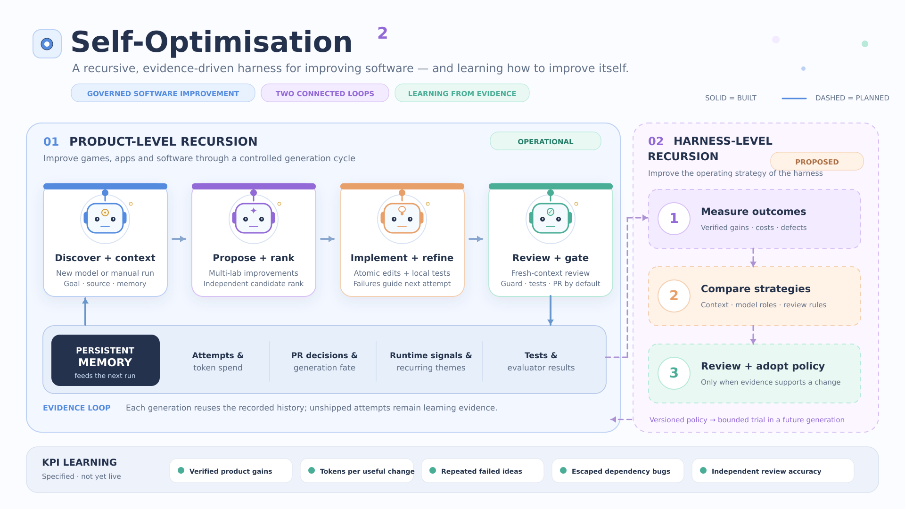

# Self-Optimisation² — illustrated harness architecture

This is a presentation-oriented overview of the recursive improvement architecture. The diagram is based on the repository's [implemented product loop](../../../ARCHITECTURE.md) and its [proposed KPI-driven harness learning loop](../../harness-kpis/README.md).

## Editable diagram

- [Edit in diagrams.net / Draw.io](self_optimisation_harness_editable.drawio) — independently editable stages, connectors, text and panels.
- [Open the SVG](self_optimisation_harness_diagram.svg) — scalable vector graphic with editable objects in suitable vector editors; renders in GitHub Markdown.

## Reading the diagram

**Product-level recursion — implemented:** model-release detection or campaign trigger → context and history → suggest/rank → implement/test/review/refine → guard and project tests → approval/pull request or opt-in merge → run records that inform later generations. Memory and runtime observations are inputs to new runs.

**Harness-level recursion — proposed:** independently assessed outcomes and KPI measurements → strategy comparisons and experiments → reviewed, versioned changes to context selection, investigation, model seats, and review policies. This learning system is **not yet automated**: existing attempt records, spend accounting and reporting are foundations, not verified product-benefit or review-accuracy measurements.

**Visual legend:** solid connections describe the operational loop; dashed connections and warm-toned areas indicate planned harness-learning capability. This diagram is an overview, not an executable workflow or a claim that the proposed feedback loop runs in production.

For executable-stage detail see [ARCHITECTURE.md](../../../ARCHITECTURE.md); for measurement definitions and implementation status see [Harness KPIs](../../harness-kpis/README.md).
