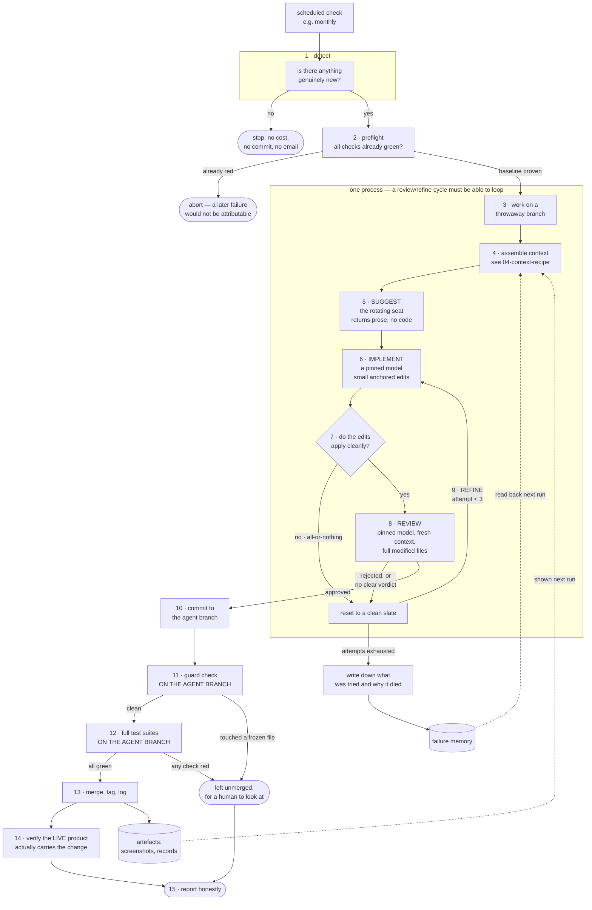

# The blueprint — building one for your project

This is the loop, described as parts you assemble rather than as principles you
agree with. It assumes you'll direct an agent to build most of it.

---

## The shape of one lap



---

## The parts, one at a time

### 1. The detector

**Job:** answer "has anything genuinely new happened?" and stop the run if not.

**Needs:** a stored snapshot of what you saw last time, and a comparison. Not a
timestamp — a *set*. "New" means "an identifier I have never seen before."

**Watch out for:** the first run against a new source, which must record a
baseline and act on nothing. And for the difference between *"I checked and
there was nothing new"* and *"I couldn't check"* — never let the second look
like the first.

### 2. The preflight

**Job:** run all your checks against the untouched project. If anything is
already red, stop before the agent starts.

**Why:** it makes every later failure attributable to the agent. Skip this and
red checks become ambiguous, and ambiguous checks get ignored.

### 3. The isolated workspace

**Job:** everything the agent does happens on a throwaway branch, never on your
main line.

**Also:** when a run fails, *leave the branch there*. That's the evidence. Only
delete it after a successful merge.

### 4. The context pack

**Job:** assemble what the model sees. This deserves its own page —
[`04-context-recipe.md`](04-context-recipe.md).

The one-line rule: **send what changes the decision, not what describes the
project.**

### 5. The suggester (the rotating seat)

**Job:** look at the project with fresh eyes and name **one** improvement.
Returns prose — and, optionally, the edits implementing it.

**Give it:** a brief with your permanent constraints, the context pack, and a
required output shape — problem, proposed change, why this beats the
alternatives, what could break, how a reviewer should verify it.

**Ask for one thing, not a list.** A list is a way of avoiding the judgement you
are paying for.

### 5b. Onboarding a new provider into the rotating seat

**Job:** add a lab to the roster without letting its quirks surface for the
first time inside a live, expensive run.

Three checks, run against the live API before anything is wired into the
pipeline proper, caught real bugs that would otherwise have cost a full run
each:

1. **Probe the real call shape, not just the model's existence.** A catalogue
   listing an id says nothing about whether it answers the request shape you
   actually send. Send a trivial request through your real code path the
   moment a candidate is selected, and drop anything that doesn't answer —
   before the expensive stages spend anything on it.
2. **Match error-recovery logic to the *shape* of a failure, not another
   vendor's wording.** A retry that drops images on "you sent something I can't
   accept" and was built by reading one lab's actual error string will miss the
   next lab's differently-worded refusal of the identical condition. Detect the
   condition (a 400 on a request that carried an attachment, from a call that
   would otherwise succeed), not the sentence.
3. **Give per-provider quirks a named slot, not a special case.** A model that
   can't disable its own reasoning, a header only one vendor requires, a field
   only one API accepts — put these in an options hook on your shared
   request-building code, opted into per-provider, rather than branching the
   shared path itself. The alternative is every future provider having to route
   around the last one's fix.

**Portable version:** treat "a new integration point" as guilty until proven
innocent, the same way principle 6 treats an unrecognised model name. The cost
of probing live is minutes. The cost of finding the gap during an unattended
run is the whole run's budget, spent on nothing.

### 6. The implementer (the suggester if it can, pinned model if it can't)

**Job:** turn that prose into small, anchored edits and apply them.

**Give the rotating seat first refusal.** Offer it the format as optional; try
its edits before the pinned model's attempts, and don't let a failed attempt
consume one. Fall back silently. Record which happened — see principle 4.

**The output format is the whole game here.** What worked:

```
SUMMARY: <one line, becomes the commit message>
RATIONALE: <2-4 sentences: why this, why now, why it is safe>

<<<EDIT>>>
FILE: <path from the allowed list>
<<<SEARCH>>>
<exact text copied from the file, including indentation>
<<<REPLACE>>>
<the replacement>
<<<END>>>
```

With these rules attached, and enforced by a parser rather than trusted:

1. The SEARCH text must appear **exactly once** in the file. If a snippet would
   be ambiguous, include more surrounding context until it isn't.
2. Never output the whole file. Never abbreviate with `...` or
   `// rest unchanged`.
3. Keep it focused: one improvement, as few edit blocks as it takes.
4. No markdown code fences around the blocks.

Add a separate `CREATE` block if you want the agent to be able to add new files
(here: only new test files, and only at paths that don't already exist).

**Also:** detect truncation. If the model's response stopped because it hit the
output limit, abort before writing anything. A partial edit set is how you
corrupt a working product.

### 7. The applier

**Job:** validate every edit against in-memory content for *all* affected files
**before writing a single byte**, then write them all or none.

Small things that matter:
- Tolerate line-ending mismatches (a file checked out on Windows vs. what the
  model emitted). Reconcile them rather than failing.
- Check the file is in the allowed list *first*, before anything else.
- Reject path traversal (`..`, absolute paths) explicitly.

### 8. The reviewer (pinned, fresh context)

**Job:** approve, or reject with **specific, actionable** required fixes.

**Give it:** the edits *and* the full current content of every touched file.
Give it a reviewer's brief, not the implementer's — a list of things that mean
REJECT and a list that mean APPROVE, and an instruction to be conservative when
genuinely uncertain, but not to reject on style.

**Require a parseable verdict, and treat anything else as rejection.**

A template is in [`06-starter-kit.md`](06-starter-kit.md).

### 9. The refine loop

**Job:** on rejection, reset to a pristine state and run the implementer again
with the reviewer's exact objections.

**Cap it at three attempts total.** Then fail honestly.

**Note on plumbing:** most CI systems cannot loop a job. A review→refine→review
cycle has to live inside a single process. Plan for that from the start — it is
why stages 5–9 here are one script rather than four steps in a workflow file.

### 10. The guard

**Job:** independently verify that the change didn't touch anything it shouldn't
have. Runs in CI, against the agent's branch.

Three kinds of rule cover almost everything:

| Rule | Meaning |
|---|---|
| **frozen** | This file may not change at all |
| **append-only** | New files may be added; existing ones may not be edited or removed |
| **frozen fields** | Named settings inside a config file must be byte-identical |

Plus a **churn ceiling** — a maximum number of files and lines per run. Not a
design constraint; a backstop that catches "this run has lost the plot."

Freeze, at minimum: your automation definitions, the agent's own brief, the
guard script itself, your test definitions, your deployment config, and the
commands that run your tests. Humans are not subject to any of this — it applies
only to branches the agent owns.

### 11. The test gates

Your existing test suites, run **against the agent's branch**. Go and check that
they really are. Then break something on purpose and confirm they go red.

### 12. The merge and the record

On green: merge, tag the generation (`gen-001`, `gen-002` …), store the
artefacts — screenshots, the proposal, the attempt record — and append one entry
to a log.

Tagging every generation is what makes the whole thing reversible. You can
bisect between generations and revert any single one cleanly.

### 12b. The measurement that is not a gate

**Job:** produce a number that means *better*, alongside the gates that mean
*not broken*.

Score what would gate a real deployment in your domain — conformance
requirements, performance on the actual target hardware, and the constraints you
have already written down as non-negotiable. Not "is it good", which cannot be
measured and will be gamed.

Store it per run, show the previous run's card to the next model, name the
weakest dimension, and **do not let it gate anything** until you have watched it
for months. A fitness function that gates before it is trusted teaches the loop
to game it.

### 13. The production check

Fetch the thing your users actually touch, and confirm it carries what was just
merged. See principle 22.

### 14. The digest

An email or message per run saying what happened. Two traps:

- **Read the real result of each step.** In GitHub Actions, `job.status` read
  from inside a running job is always `success`, so this project's digest
  reported success even when the run had failed. Read the *dependency* results.
- **Make "unknown" loud.** A silent failure that reports "unknown" every month
  is a failure nobody reads.

---

## The smallest useful version

You do not need all of it on day one. In build order:

1. **Detector + preflight + branch.** Prove the loop wakes, decides there's
   nothing to do, and stops. Cheap and boring and it will catch three bugs.
2. **Suggest → implement → apply, with the anchored-edit format.** Get one real
   change onto a branch, by hand-triggering it.
3. **The guard.** Before you ever let it merge. Test it by making the agent try
   to touch a frozen file.
4. **The test gates, verified to actually see the change.** Break something and
   watch it go red.
5. **The review stage and the refine loop.** Quality goes up sharply here.
6. **Merge + tag + log + digest.** Now it's autonomous.
7. **The failure memory and the artefacts.** Now it accumulates.
8. **The production check.** Now you'd know if it stopped mattering.
9. **The scorecard.** Now you'd know if it were actually helping.

Steps 1–4 are a weekend. Everything after that is the difference between a demo
and something you can leave alone.

---

## What this costs

For a small project, per run, roughly:

- **Detection:** one API call per source. Free or near-free.
- **Model calls:** one per rotating candidate, plus one rank, one implement, one
  review. Here that's a context pack of ~59k tokens plus images per candidate.
  Single-digit to low-tens of dollars per generation.
- **CI:** a few minutes per run.
- **Storage:** ~1 MB of screenshots per generation.

The honest risk is that **cost scales with how busy the outside world is**, not
with a number you chose. A month where six labs all ship is six context packs
before you've implemented anything. Cap the fan-out with a constant, and set a
real spending limit at the provider — a constant in a file is not a budget.
