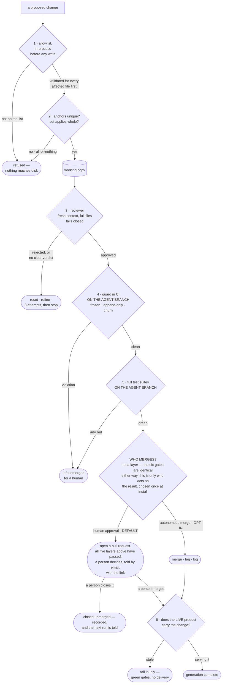

# Guardrails and trust — leaving an agent alone

Most of the engineering in this project is not about making changes. It is about
making sure a bad one cannot reach a person.

The framing that makes the rest of it obvious: **a machine edits a live product
that real people use, with nobody watching.** Every gate exists because the
alternative is a broken product at three in the morning.

---

## The layers

Six layers, and they fail in different ways on purpose: layers 1–3 fail *quietly
and retry*, layers 4–6 fail *loudly and stop*.

---

## What to freeze

The rule is one sentence: **an agent that can edit its own rules has no rules.**
The cheapest way to make a failing build pass is to delete the test.

Freeze, at minimum:

| Thing | Why |
|---|---|
| The automation definition | It defines the schedule and every gate |
| The agent's own brief | It defines what the agent may do |
| The guard script | It enforces all of the above |
| Test definitions | Append-only: new tests welcome, edits never |
| The commands that run tests | Rewriting `test` to `exit 0` defeats everything else |
| Deployment and security config | Not the agent's to renegotiate |
| Anything defining your safety posture | Same reason |

Add a **churn ceiling** — a maximum number of files and lines per run. It is not
a design constraint; it's a backstop for "this run has lost the plot".

Two refinements worth copying:

- **Append-only is more useful than frozen** for tests. Adding coverage is
  genuinely good autonomous work. Loosening an existing test is how a run makes
  itself look successful.
- **Frozen *fields*, not just frozen files.** A config file can be legitimately
  editable while specific keys inside it must be byte-identical.

And the thing people forget: **humans are not subject to any of this.** The
guard runs only against branches the agent owns. A person can change any of it
directly — that's the whole point of the asymmetry.

---

## The escape valve: arguing without editing

"Frozen forever" and "no one can ever question it" are different guarantees,
and a system that only means the first can quietly end up implementing the
second — the brief turns out to have a real mistake in it, and the only thing
positioned to notice is the thing not allowed to speak.

The fix is a documented channel for dissent that never grants edit access.
Every asked model answers one more required field: a specific case for
changing something it may not touch. Nothing acts on it automatically. Each
case is recorded to a ledger and shown to every future model, so a settled
question isn't re-argued from scratch — and once **several independent
models, from more than one lab,** have separately backed the *same* case, a
human is notified to decide. The threshold is the load-bearing part: one
model's opinion is noise, but convergent agreement from parties that share no
context with each other and no incentive to agree is a real signal worth a
human's attention.

This is not a loophole in "an agent that can edit its own rules has no rules."
The frozen layer still cannot move itself, under any circumstance — a human
decides, and can also change any of it directly at any time regardless of
whether the ledger has an entry. What changes is that the case for moving it no
longer depends on a person happening to notice on their own.

---

## Allowlist, never denylist

The list of files the agent may edit is an **allowlist**: an unknown path is
refused rather than permitted. New files someone adds next year are frozen by
default rather than accidentally editable.

The same list is enforced **twice** — once in the process before anything is
written, once in CI against the agent's branch, by a completely separate script.
The first protects the working copy. The second is the one a human sees the
result of, and it still works if the first has a bug.

---

## How to decide "fail closed" or "fail safe"

For every automated decision, ask: *does this step protect something?*

| Step | Mode | Behaviour on garbage output |
|---|---|---|
| Reviewer verdict | **fail closed** | Unparseable = rejected. Uncertainty is a "no". |
| Guard check | **fail closed** | Can't determine? Don't merge. |
| Ranking between proposals | **fail safe** | Fall back to a sensible default; the run continues. |
| Fetching optional context | **fail safe** | Omit the section; never fail the run. |
| One source of many erroring | **fail safe** | Drop that one, continue with the rest. |

Write this table for your own loop before you build it. The failure behaviour of
each step is a design decision, and if you don't make it deliberately you will
make it accidentally.

---

## The reviewer's brief

The reviewer is a different job from the implementer and needs a different
brief. What worked here:

1. **Tell it the stakes, plainly.** *"Nobody is watching this run. If you
   approve a broken change it reaches the live site."*
2. **Give it an explicit REJECT list** — the specific things that mean no
   (breaks the render loop, breaks input handling, adds a dependency, breaks
   backwards compatibility, introduces data collection, sprawls beyond the
   stated change).
3. **Give it an explicit APPROVE list** — all must hold.
4. **Calibrate it in both directions:** *"Be conservative: when genuinely
   uncertain about correctness, reject and say why. Do not reject for style
   preferences, or for not doing more than it set out to do."* Without the
   second sentence, reviewers reject everything and the loop stalls.
5. **Require a machine-readable verdict**, and treat its absence as rejection.
6. **Require specific required fixes on rejection** — this is what the refine
   loop consumes. "Looks risky" is useless. "The drawing function expects the
   context configured at line 4200; your code modifies it at line 5100" is a
   working instruction.

Full template in [`06-starter-kit.md`](06-starter-kit.md).

---

## Reversibility and audit

Every generation is:

- **A tag.** `gen-001`, `gen-002`. You can bisect between generations and revert
  any one of them cleanly.
- **One idea.** Focused diffs are reviewable a year later. Grab-bags are noise.
- **A record.** The proposal, the review, the attempts, and screenshots, stored
  per generation.
- **A log entry.** Append-only. Failed generations stay logged as data;
  deletions are not permitted.

Screenshots per generation turned out to be the most valuable artefact of the
whole experiment — a flip-book of the product's visual evolution that no text
log can substitute for.

**Write the record from the crash handler too.** "On success and on failure"
covers two paths. A stage that throws instead of returning — a call that spends
its whole budget on hidden reasoning and comes back with no usable text, say —
follows neither, and code that only writes the record on the two paths it
anticipated will leave a generation completely unlogged the one time something
actually breaks. Wire a process-level handler that writes what's known so far
on the way down, not just from the paths designed to exit politely.

**How to stop:** comment out the schedule, commit. The loop stops; nothing
spawns. All prior generations remain in history and remain auditable. Make sure
this is one step, and write it down where someone panicking can find it.

---

## What you still cannot measure

The hard part, and the reason to stay sceptical of your own loop.

**No gate measures better.** Tests, guards and a reviewer all measure *not
broken*. A change that passes every check and quietly makes the product worse
would still ship.

There is now a **readiness scorecard** running alongside the gates: six measured
dimensions, 0–100, recorded per generation and shown to the next model. It does
not gate the merge and nothing optimises against it yet — deliberately, because
a fitness function that gates before it is trusted only teaches the loop to game
it. So the gap has moved from *nothing measures better* to *the measurement is
not yet wired to selection*.

If you build one of these, this is the highest-value thing you can add, and the
trap is trying to score "is it good". Score instead **what would gate a real
deployment in your domain**: conformance requirements, performance on the actual
target device, and the constraints you have already written down as
non-negotiable. Those are measurable without asking anyone's opinion, and they
are what "better" means in practice.

Ours found a real defect on its first run that 239 existing checks had missed —
two pages loading a webfont from a third party over a render-blocking import, on
a project whose brief calls external dependencies non-negotiable. With that host
unreachable, first paint stalled about thirteen seconds. Everything else was
green.

**And a fitness function can be gamed by a well-behaved optimiser, not just an
adversarial one.** The scorecard's own weakest dimension, for a while, was a
readability score computed over the page's rendered text — which cannot see a
canvas at all. Every part of the product that metric *could* see was a caption
a caregiver reads, so the cheapest honest way to raise the number was to
simplify some prose and leave a lethal-looking-friendly hazard exactly as it
was. Three models, three different labs, independently proposed some version
of that trade — none of them cheating, each one correctly solving the problem
as measured. It was replaced with a probe that drives real play in an actual
browser and judges the canvas by its own draw calls, so an unreachable state
scores nothing rather than defaulting to a pass. Score moved from 44 to 79 on
the same code, because the metric changed, not the game. Before trusting any
score, ask what part of the real thing it is structurally blind to — that gap
is exactly where a competent optimiser, human or model, will go looking.

**Search is half-pulled.** Several candidates are generated in parallel and one
is picked. But the losing candidates are discarded rather than implemented and
measured — only the winner reaches a gate. Generating N and *measuring* N is the
trade that actually scales, and it needs the fitness function first.

**The reviewer and the implementer share a mind.** Fresh context and a different
brief, but not an independent one. A shared blind spot stays blind. If your
stakes are higher than a children's game, use a genuinely different model for
the review seat.

**The judge is one of the contestants.** Where a pinned model ranks proposals
from rotating models, one lab's taste decides which lab's idea ships — inside a
project whose premise is rotating that seat. Hiding the authors from the ranker
blunts it. It does not remove it. Name the compromise out loud rather than
papering over it.

**And the failure mode that beats all of the above:** the loop running every
month, emailing success, and doing nothing of value. The pipeline reports what
it did. It cannot report what it should have done. Put a human in front of the
generation log every few months and ask, honestly, whether it is getting better.
